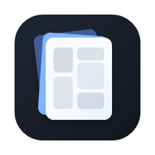
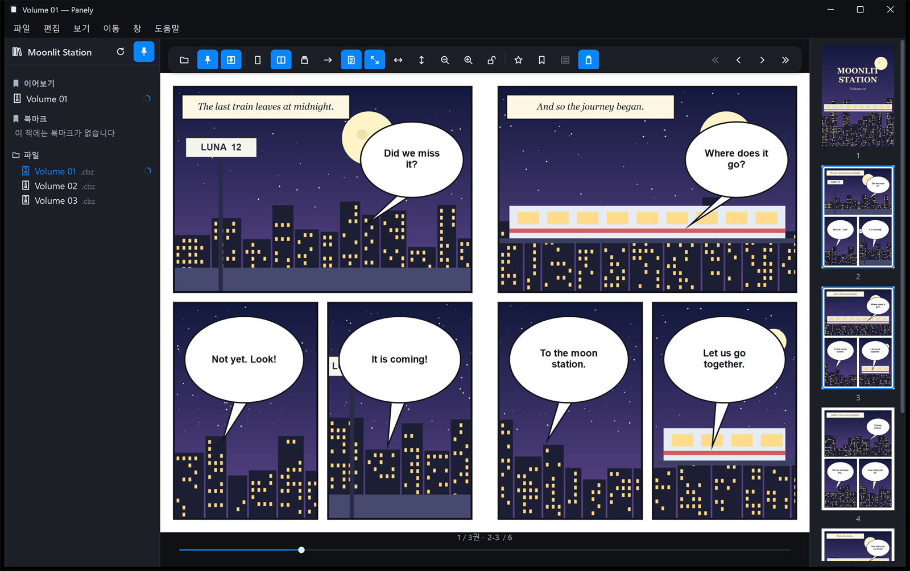
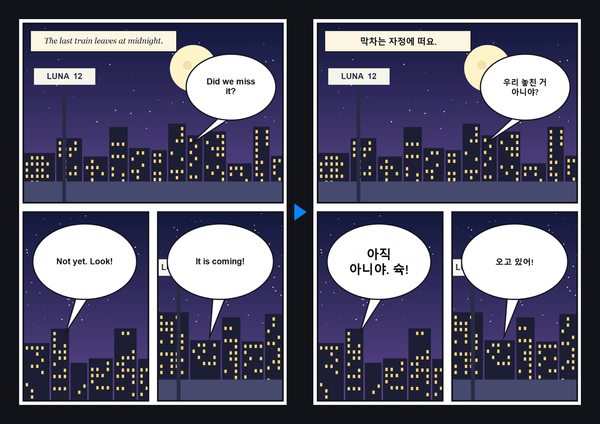
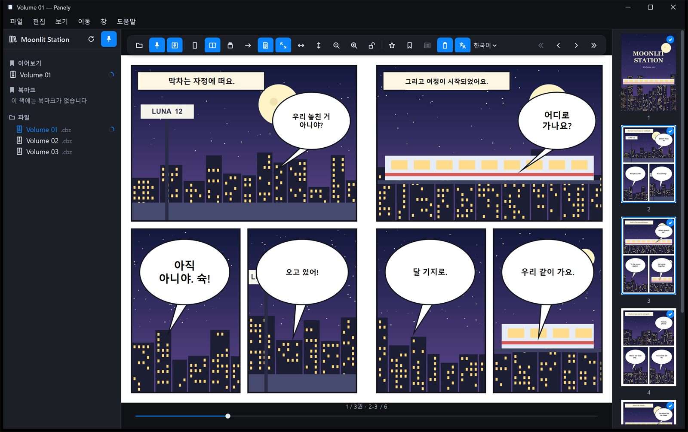

<div align="center">



# Panely for Windows

**빠르고 오프라인으로 동작하는 Windows용 만화·망가 리더. 기기 안에서 말풍선을 번역하는 실험 기능을 함께 제공합니다.**

[](#요구-사항)
[](https://dotnet.microsoft.com/download/dotnet/10.0)
[](#프로젝트-구성)
[](#번역실험-기능)
[](#번역실험-기능)
[](LICENSE)

[English](README.md) · **한국어**

**[사용 설명서](docs/manual.ko.md)** · [내려받기](https://github.com/sejoung/PanelyWindows/releases/latest)

Mac을 쓰시나요? [macOS용 Panely](https://github.com/sejoung/Panely)를 보세요.



</div>

## 기능

**읽기**
- 한 쪽, 두 쪽 펼침(표지 단독 선택), 웹툰용 세로 연속 스크롤
- 망가용 오른쪽→왼쪽 읽기. 화면 순서만 바뀌어 키보드·마우스 조작은 그대로입니다
- 화면·가로·세로 맞춤, 커서 기준 확대, 크기 잠금, 시리즈별 배율 기억
- 쪽 슬라이더, 쪽 이동, 썸네일, 권 사이의 "다음 권"·"이전 권" 카드

**라이브러리**
- 자동 갱신되는 파일 트리, 진행 링이 있는 이어보기, 최근 항목, 즐겨찾기, 쪽 북마크
- 마지막 폴더와 시리즈별 읽기 방향·레이아웃·맞춤·번역 설정을 기억

**파일**
- 폴더, ZIP/CBZ, RAR/CBR(RAR4·RAR5·solid). 확장자가 아니라 파일 헤더로 형식을 판별합니다
- JPEG, PNG, WebP, GIF, HEIC/HEIF, BMP, TIFF. 자연 정렬("2"가 "10"보다 앞), EXIF 회전 반영
- 중첩 압축 파일(깊이 3, 크기·파일 수 한도 보호)과 용량 제한이 있는 추출 캐시

**Windows 통합**
- 다크 테마와 어두운 제목 표시줄, 영어·한국어 UI(기본은 시스템 언어)
- 단일 인스턴스: 탐색기에서 다른 책을 열면 실행 중인 창으로 넘깁니다
- ZIP/RAR 기본 앱을 바꾸지 않는 "Panely로 열기" 등록(선택)
- 관리자 권한이 필요 없고, self-contained 빌드는 .NET 없이 실행됩니다

## 번역(실험 기능)

말풍선을 찾고 글자를 읽어 페이지 위에 번역을 그립니다. **모든 처리가 내 PC 안에서** 이뤄지며 온라인 서비스로 아무것도 보내지 않습니다.

<div align="center">

</div>

- 원문 언어: 일본어(세로쓰기 포함), 중국어, 영어, 한국어. 원문 언어는 자동으로 감지할 수 있습니다
- 원본과 번역을 전환하고, 시리즈 전체를 백그라운드에서 번역하고, 말풍선을 직접 고치거나 숨기거나 추가할 수 있습니다
- 번역본을 CBZ·ZIP·폴더로 내보내거나, 파일로 원하는 AI 채팅 서비스에 맡겼다가 결과를 가져올 수 있습니다
- 모델은 고정된 revision에서 한 번 내려받고, 쓰기 전에 SHA-256으로 검증합니다

| 단계 | 모델 | 크기 | 처리 장치 |
|---|---|---|---|
| 말풍선 탐지 | [comic-text-and-bubble-detector](https://huggingface.co/ogkalu/comic-text-and-bubble-detector) (RT-DETR) | 약 170MB | GPU(DirectML), 안 되면 CPU |
| 일본어 글자 인식 | [manga-ocr](https://huggingface.co/ogkalu/manga-ocr-onnx) (int8) | 약 117MB | CPU |
| 중국어·영어·한국어 글자 인식, 언어 감지, 글자 줄 찾기 | [PP-OCRv5 mobile](https://huggingface.co/ogkalu/ppocr-v5-onnx) | 약 43MB | 줄 찾기는 GPU, 읽기는 CPU |
| 번역 — 빠름 | [M2M100-418M](https://huggingface.co/Xenova/m2m100_418M) (int8) | 약 640MB | CPU |
| 번역 — 정확 | M2M100-418M (fp32) | 약 2.5GB | CPU |

장치 배분은 실측 결과입니다. 말풍선 탐지와 글자 줄 찾기는 GPU가 빠르고, 글자 읽기와 번역 모델은 CPU가 더 빠릅니다. 글자 읽기와 번역은 함께 돌고, 번역기에는 여러 쪽의 말풍선이 한꺼번에 들어갑니다. `PANELY_ORT_DEVICE=cpu`로 GPU를 완전히 끌 수 있습니다.

> [!NOTE]
> 번역 품질은 작은 M2M100 모델의 한계가 있습니다. 짧은 대사와 관용 표현은 자주 틀리며, 위 예시에도 틀린 말풍선이 있습니다. 모델이 번역하지 못한 말풍선은 원문을 그대로 보여 주며, 말풍선 편집에서 어떤 말풍선이든 직접 고칠 수 있습니다. 정확 모드는 메모리를 약 2GB 더 쓰지만, 나란히 비교해 본 결과 번역이 훨씬 나았습니다.

## 시작하기

### 요구 사항

- Windows 10 버전 2004(빌드 19041) 이상. 1차 대상은 Windows 11 x64입니다
- 소스에서 빌드하려면 [.NET 10 SDK](https://dotnet.microsoft.com/download/dotnet/10.0)(배포 ZIP은 .NET 없이 실행됩니다)
- 번역: 빠름 언어팩에 디스크 약 1GB. DirectX 12 GPU가 있으면 말풍선 탐지가 빨라집니다

### 내려받기

[Releases](https://github.com/sejoung/PanelyWindows/releases/latest)에서 PC에 맞는 포터블 ZIP을 받습니다.

| 파일 | 대상 |
|---|---|
| `Panely-<버전>-win-x64.zip` | 대부분의 Windows PC(Intel·AMD) |
| `Panely-<버전>-win-arm64.zip` | ARM 기반 Windows(Snapdragon 등). 빌드와 구성 파일은 확인했지만 실제 ARM 기기에서는 아직 실행해 보지 않았습니다 |

ZIP을 계속 둘 폴더(예: `%LOCALAPPDATA%\Programs\Panely`)에 풀고 `Panely.exe`를 실행합니다. 설치 프로그램이나 관리자 권한은 필요 없습니다. 체크섬은 릴리스 페이지의 `SHA256SUMS.txt`에 있습니다.

> [!NOTE]
> 아직 코드 서명이 없어 처음 실행할 때 Windows SmartScreen이 "Windows의 PC 보호" 창을 띄울 수 있습니다. **추가 정보 › 실행**을 누르세요.

업데이트할 때는 Panely를 닫고 폴더 내용을 새 ZIP으로 바꿉니다. 지울 때는 "Panely로 열기"를 추가했다면 먼저 **설정 › 일반**에서 **파일 탐색기에서 제거**를 누른 뒤 폴더를 지웁니다. 라이브러리, 읽기 진행, 언어팩은 `%LOCALAPPDATA%\Panely`에 남으며, 이 폴더까지 지우면 모두 삭제됩니다.

### 소스에서 빌드·설치·실행

저장소를 받은 뒤 루트에서 설치 스크립트를 실행합니다.

```powershell
git clone https://github.com/sejoung/PanelyWindows.git
cd PanelyWindows
install-local.cmd
```

빌드와 테스트를 거쳐 `%LOCALAPPDATA%\Programs\Panely`에 self-contained 앱을 설치하고, 시작 메뉴에 **Panely (Local)** 바로 가기를 만든 뒤 실행합니다.

```powershell
install-local.cmd -SkipTests                 # 설치만(몇 초)
install-local.cmd -Open "D:\Comics\Series A" # 설치 후 폴더 열기
uninstall-local.cmd                          # 설치 제거. 사용자 데이터는 남습니다
```

포터블 ZIP을 만들려면:

```powershell
powershell -ExecutionPolicy Bypass -File tools\publish.ps1                 # artifacts\Panely-win-x64.zip
powershell -ExecutionPolicy Bypass -File tools\publish.ps1 -Runtime win-arm64
```

### 번역 켜기

**설정 › 실험적 기능**에서 번역을 켜고, 번역 패널에서 언어팩을 내려받습니다. 그 뒤로는 네트워크 없이 번역합니다.

<div align="center">

</div>

## 단축키

| 동작 | 키 |
|---|---|
| 열기 / 설정 | `Ctrl+O` / `Ctrl+,` |
| 한 쪽 / 두 쪽 / 세로 | `Ctrl+Shift+1` / `2` / `3` |
| 화면·가로·세로 맞춤 | `Ctrl+1` / `2` / `3` |
| 확대 / 축소 / 초기화 | `Ctrl++` / `Ctrl+-` / `Ctrl+0` |
| 다음 / 이전 쪽 | `Space`, 방향키(읽기 방향 반영) |
| 이전 / 다음 권 | `[` / `]` |
| 쪽 이동 / 북마크 / 즐겨찾기 | `Ctrl+G` / `Ctrl+D` / `Ctrl+Shift+D` |
| 라이브러리·툴바 고정, 썸네일 | `Ctrl+Alt+S` / `T` / `P` |
| 원본↔번역 / 번역 실행 / 말풍선 편집 / 작업 창 | `Ctrl+Shift+T` / `Ctrl+Alt+Y` / `Ctrl+Shift+E` / `Ctrl+Alt+J` |
| 전체 화면 | `F11` |

모든 명령은 메뉴에도 있습니다. 전체 목록은 [`CommandRegistry.cs`](src/Panely.Core/Commands/CommandRegistry.cs)에 있습니다.

## 개발

### 프로젝트 구성

| 프로젝트 | 역할 |
|---|---|
| `src/Panely.Domain` | 순수 계산: 펼침, 맞춤·줌, 휠 쪽 넘김, 자연 정렬, OCR 타일, 말풍선 묶기, 패치 배치 |
| `src/Panely.Core` | 파일·압축, 추출 캐시, 상태 저장, 진단, 라이브러리 감시, 번역·내보내기 작업 큐, 모델 관리, ONNX 어댑터, 문구 |
| `src/Panely.App` | WPF UI: 리더 창, 툴바, 라이브러리, 뷰어, 썸네일, 설정, 작업 창, 번역 패널·편집 |
| `tests/Panely.Tests` | 단위·계약 테스트. `Vectors/`에 계산 기대값, 저장 형식 스키마, 예제 |
| `tests/Panely.App.Tests` | 테마, 단축키, 이미지 디코딩, 패치 렌더링, 실제 앱을 띄우는 smoke 테스트 |
| `tools/` | 빌드·설치·검증·게시 스크립트, QA 샘플 생성기, 아이콘 생성기 |

### 스크립트

루트의 `.cmd`는 인자를 같은 이름의 `tools\*.ps1`로 넘깁니다. `dotnet`은 `PATH`나 `%LOCALAPPDATA%\Microsoft\dotnet`에서 찾습니다.

| 스크립트 | 하는 일 |
|---|---|
| `verify.cmd` | 린트, 경고 없는 빌드, 테스트·커버리지, 스크립트 검사, 앱 smoke, 게시본 smoke를 한 번에 실행하고 요약 (`-Quick`, `-Fix`, `-MinCoverage 80`) |
| `build.cmd` | 솔루션 빌드와 테스트 (`-Configuration Release`, `-SkipTests`, `-Filter Translation`, `-Clean`) |
| `install-local.cmd` | 빌드·테스트·게시 후 로컬 설치·실행 (`-SkipTests`, `-Samples`, `-Isolated`, `-Open <경로>`) |
| `uninstall-local.cmd` | 로컬 설치 제거 (`-RemoveDevData`, `-RemoveData`) |
| `release.cmd` | `main`에서 검증 후 `VersionPrefix`와 `app.manifest` 버전 올림·커밋·태그·push (`patch`, `minor`, `major` 또는 `X.Y.Z`; `-DryRun`, `-SkipVerify`, `-Yes`). 먼저 `docs/releases/vX.Y.Z.md`를 써서 커밋하세요. 릴리스 노트로 쓰입니다 |

변경을 보내기 전에 `verify.cmd`를 실행하세요(약 40초, `-Quick`은 smoke 생략). 스타일 규칙은 `.editorconfig`에 있고 분석기 경고는 빌드를 실패시킵니다.

```powershell
dotnet build Panely.sln
dotnet test tests/Panely.Tests
dotnet run --project src/Panely.App -- "D:\Comics\Series A"
powershell -ExecutionPolicy Bypass -File tools\make-samples.ps1 -Out D:\PanelySamples   # QA 샘플 라이브러리
powershell -ExecutionPolicy Bypass -File tools\readme-screenshots.ps1                   # docs\images 다시 만들기
powershell -ExecutionPolicy Bypass -File tools\manual-screenshots.ps1                   # docs\images\manual 다시 만들기
```

`readme-screenshots.ps1`은 합성 데모 만화(`tools\make-demo.ps1`)를 설치된 앱으로 열어, 실제 데이터와 분리된 데이터 폴더에서 영어·한국어 UI의 원본·번역 화면을 찍습니다. 먼저 앱을 설치하고 언어팩을 받아 두세요. 실행하는 동안(약 1분) Panely 창이 여러 번 열리고 닫힙니다.

`manual-screenshots.ps1`은 같은 방식으로 사용 설명서 화면을 찍으며, 메뉴는 UI Automation으로 실행합니다. Release 빌드가 있으면 그것을 씁니다. 실행하는 동안(약 3분) 마우스를 건드리지 마세요. 말풍선 하나를 클릭하는데, 그 위치가 Panely 창일 때만 누릅니다.

### 데이터와 환경 변수

사용자 데이터는 `%LOCALAPPDATA%\Panely\`에 있습니다: `Data\state.json`, `Data\edits\`(직접 고친 말풍선), `Cache\`(추출·번역·썸네일), `Diagnostics\`, `Models\`. 캐시를 지워도 데이터와 모델은 남습니다.

| 변수 | 용도 |
|---|---|
| `PANELY_DATA_ROOT` | 데이터 폴더 바꾸기(테스트·포터블) |
| `PANELY_ORT_DEVICE=cpu` | 모든 모델을 CPU로 실행 |
| `PANELY_DEV_PSEUDO_TRANSLATION=1` | 모델 없이 UI를 확인하는 가짜 번역 공급자(UI에 표시됨) |
| `PANELY_TEST_DETECTOR_MODEL` | `detector.onnx` 경로를 주면 탐지 통합 테스트 실행 |

### 문서

- [설계 결정 기록(ADR)](docs/adr/) — 왜 이렇게 만들었는지
- [구현 현황](docs/IMPLEMENTATION-STATUS.md) — 검증한 내용과 알려진 한계

## 기여

이슈와 풀 리퀘스트를 환영합니다. 풀 리퀘스트 전에 `verify.cmd`를 실행해 주시고, 나중에 다른 사람이 이유를 알아야 할 설계 결정을 했다면 `docs/adr/`에 ADR을 추가해 주세요.

## 라이선스

Panely for Windows는 [Apache License 2.0](LICENSE)을 따릅니다.

앱 아이콘, 문구 카탈로그, 화면 디자인은 원본인 [macOS용 Panely](https://github.com/sejoung/Panely)의 자산입니다(Apache-2.0, [`assets/LICENSE-original.txt`](assets/LICENSE-original.txt)). 글자 인식 구성은 [comic-translate](https://github.com/ogkalu2/comic-translate)를 참고했습니다. 사용한 라이브러리와 모델의 라이선스는 [THIRD-PARTY-NOTICES.md](THIRD-PARTY-NOTICES.md)에 정리했습니다. 모델은 사용자가 직접 내려받으며 이 저장소가 재배포하지 않습니다.

스크린샷은 이 README를 위해 만든 합성 데모 만화를 사용했습니다.
