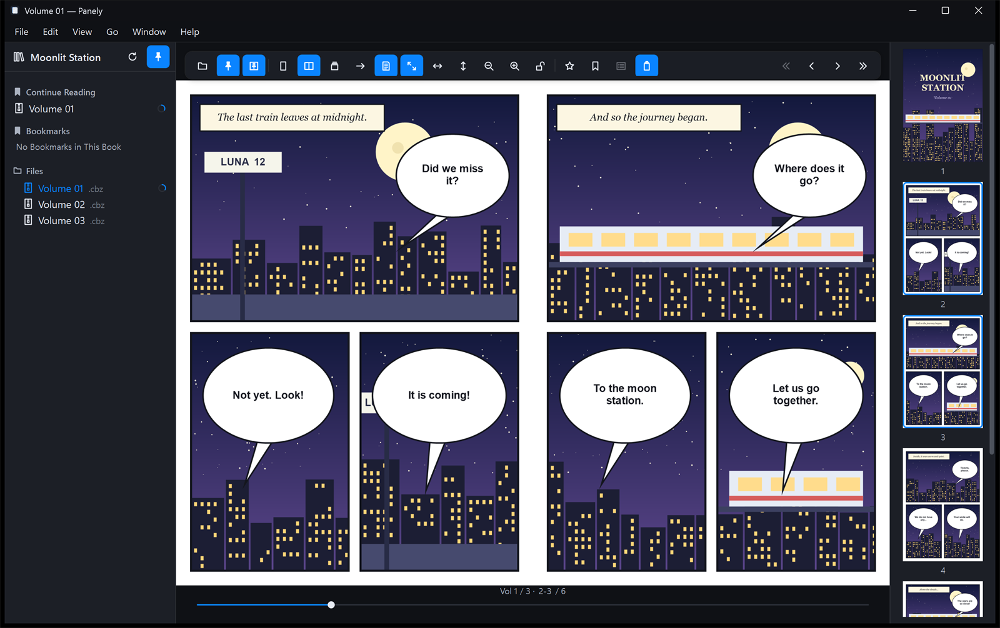
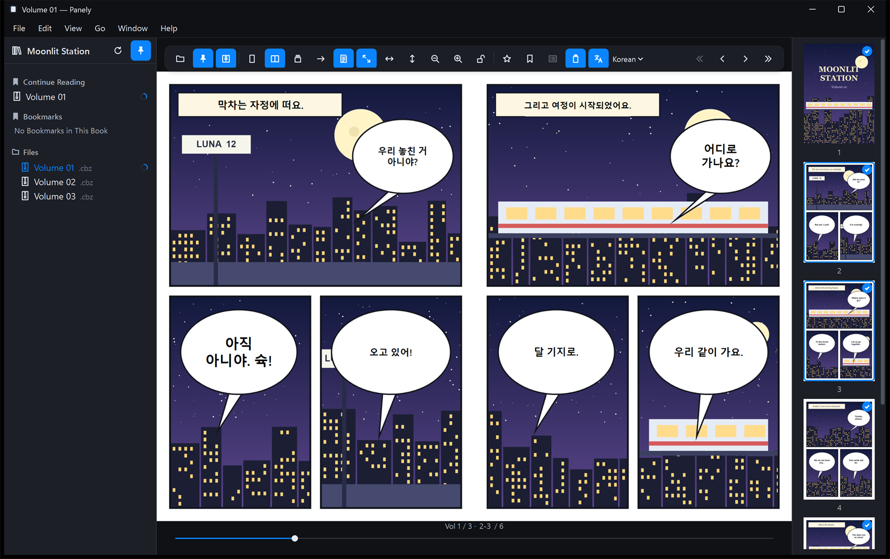

<div align="center">


# Panely for Windows

**A fast, offline comic and manga reader for Windows — with experimental on-device balloon translation.**

[](#requirements)
[](https://dotnet.microsoft.com/download/dotnet/10.0)
[](#project-layout)
[](#translation-experimental)
[](#translation-experimental)
[](#translation-experimental)
[](LICENSE)
[](https://github.com/sejoung/PanelyWindows/releases/latest)
[](https://github.com/sejoung/PanelyWindows/releases)
[](https://github.com/sejoung/PanelyWindows/actions/workflows/ci.yml)

**English** · [한국어](README.ko.md)

**[User Guide](docs/manual.md)** · [Download](https://github.com/sejoung/PanelyWindows/releases/latest)

On a Mac? See [Panely for macOS](https://github.com/sejoung/Panely).



</div>

## Features

**Reading**
- Single page, two-page spread (with an optional standalone cover) and continuous vertical scroll for webtoons
- Right-to-left mode for manga; only the on-screen order flips, so keyboard and mouse stay natural
- Fit to screen / width / height, cursor-anchored zoom, size lock, and per-series zoom memory
- Page slider, go-to-page, thumbnail strip, and "Up next" / "Previous volume" cards between volumes

**Library**
- File tree with live refresh, continue reading with progress rings, recents, favorites and page bookmarks
- Remembers the last folder and per-series direction, layout, fit and translation settings

**Files**
- Folders, ZIP/CBZ and RAR/CBR (RAR4, RAR5, solid), detected by file header rather than extension
- JPEG, PNG, WebP, GIF, HEIC/HEIF, BMP and TIFF, with natural sort ("2" before "10") and EXIF rotation
- Nested archives (depth 3, guarded size and file-count limits) and a bounded extraction cache

**Windows integration**
- Dark theme with dark title bars, English and Korean UI (follows the system by default)
- Single instance: opening another book from Explorer hands it to the running window
- Optional "Open with Panely" entry without taking over the default ZIP/RAR app
- No administrator rights required; a self-contained build runs without a .NET install

## Translation (experimental)

Panely can find speech balloons, read the text and draw a translation over the page — **entirely on your PC**. Nothing is sent to an online service.

<div align="center">

</div>

- Source languages: Japanese (including vertical text), Chinese, English and Korean; the language can be detected automatically
- Switch between the original and the translation, translate whole series in the background, and edit, hide or add balloons by hand
- Export translated books as CBZ, ZIP or a folder, or round-trip the text through an AI chat service of your choice using a file
- Models are downloaded once from pinned revisions and checked by SHA-256 before use

| Step | Model | Size | Runs on |
|---|---|---|---|
| Balloon detection | [comic-text-and-bubble-detector](https://huggingface.co/ogkalu/comic-text-and-bubble-detector) (RT-DETR) | ~170 MB | GPU (DirectML), CPU fallback |
| Japanese text | [manga-ocr](https://huggingface.co/ogkalu/manga-ocr-onnx) (int8) | ~117 MB | CPU |
| Chinese / English / Korean text, language detection, line finding | [PP-OCRv5 mobile](https://huggingface.co/ogkalu/ppocr-v5-onnx) | ~43 MB | Line finding on GPU, reading on CPU |
| Translation | [Gemma 4 E2B](https://huggingface.co/google/gemma-4-E2B-it-qat-q4_0-gguf) (GGUF q4_0, run in-app with [llama.cpp](https://github.com/ggml-org/llama.cpp) via LLamaSharp) | ~3.3 GB | GPU (Vulkan), CPU fallback |

The device split comes from measurements: balloon detection, text-line finding and translation are faster on the GPU, while the small text-reading models are faster on the CPU. Reading and translation run at the same time; the translator gets 16 balloons at a time together with the lines just before them, so it keeps each speaker's speech level and names. Set `PANELY_ORT_DEVICE=cpu` to turn off the GPU entirely.

> [!NOTE]
> Translation is a small on-device model, so mistakes happen, especially when the text recognition misreads the original. Balloons the model can't translate keep their original text, and you can correct any balloon in Edit Balloons. On a PC without a usable GPU, translation runs on the CPU and is several times slower; see the [user guide](docs/manual.md#6-getting-started-with-translation).

## Getting started

### Requirements

- Windows 10 version 2004 (build 19041) or later; Windows 11 x64 is the primary target
- [.NET 10 SDK](https://dotnet.microsoft.com/download/dotnet/10.0) to build from source (the release ZIPs don't need .NET)
- For translation: about 3.7 GB of disk space for the language packs; a GPU with a Vulkan driver (most NVIDIA, AMD and Intel GPUs) speeds up translation, and any DirectX 12 GPU speeds up detection

### Download

Get the portable ZIP for your PC from [Releases](https://github.com/sejoung/PanelyWindows/releases/latest):

| File | For |
|---|---|
| `Panely-<version>-win-x64.zip` | Most Windows PCs (Intel and AMD) |
| `Panely-<version>-win-arm64.zip` | Windows on ARM (e.g. Snapdragon). Builds and packages are checked, but it hasn't been run on an ARM device yet |

Extract the ZIP to a folder you keep, such as `%LOCALAPPDATA%\Programs\Panely`, and run `Panely.exe`. No installer or administrator rights are needed. `SHA256SUMS.txt` on the release page lists the checksums.

> [!NOTE]
> The app isn't code-signed yet, so Windows SmartScreen may show "Windows protected your PC" on first launch. Choose **More info › Run anyway**.

To update, close Panely and replace the folder's contents with the new ZIP. To uninstall, first click **Remove from File Explorer** in **Settings › General** if you added "Open with Panely", then delete the folder. Your library, reading progress and language packs stay in `%LOCALAPPDATA%\Panely` until you delete that folder too.

### Build, install and run from source

Clone the repository and run the installer script from the repository root:

```powershell
git clone https://github.com/sejoung/PanelyWindows.git
cd PanelyWindows
install-local.cmd
```

This builds and tests the app, publishes a self-contained copy to `%LOCALAPPDATA%\Programs\Panely`, adds a **Panely (Local)** Start menu shortcut and starts it.

```powershell
install-local.cmd -SkipTests                 # install only (a few seconds)
install-local.cmd -Open "D:\Comics\Series A" # open a folder after installing
uninstall-local.cmd                          # remove the install; your data stays
```

To make a portable ZIP instead:

```powershell
powershell -ExecutionPolicy Bypass -File tools\publish.ps1                 # artifacts\Panely-win-x64.zip
powershell -ExecutionPolicy Bypass -File tools\publish.ps1 -Runtime win-arm64
```

### Turning on translation

Open **Settings › Experimental** and turn on translation, then download the language pack from the translation panel. After that, translation works offline.

<div align="center">

</div>

## Keyboard shortcuts

| Action | Keys |
|---|---|
| Open / Settings | `Ctrl+O` / `Ctrl+,` |
| Single / two-page / vertical | `Ctrl+Shift+1` / `2` / `3` |
| Fit screen / width / height | `Ctrl+1` / `2` / `3` |
| Zoom in / out / reset | `Ctrl++` / `Ctrl+-` / `Ctrl+0` |
| Next / previous page | `Space`, arrow keys (follow reading direction) |
| Previous / next volume | `[` / `]` |
| Go to page / bookmark / favorite | `Ctrl+G` / `Ctrl+D` / `Ctrl+Shift+D` |
| Pin library / toolbar, thumbnails | `Ctrl+Alt+S` / `T` / `P` |
| Original ↔ translation / translate / edit balloons / jobs | `Ctrl+Shift+T` / `Ctrl+Alt+Y` / `Ctrl+Shift+E` / `Ctrl+Alt+J` |
| Full screen | `F11` |

Every command is also in the menus; the full list is in [`CommandRegistry.cs`](src/Panely.Core/Commands/CommandRegistry.cs).

## Development

### Project layout

| Project | Role |
|---|---|
| `src/Panely.Domain` | Pure logic: spreads, fit and zoom, wheel paging, natural sort, OCR tiling, balloon grouping, patch layout |
| `src/Panely.Core` | Files and archives, extraction cache, state storage, diagnostics, library watching, translation and export queues, model management, ONNX adapters, strings |
| `src/Panely.App` | WPF UI: reader window, toolbar, library, viewer, thumbnails, settings, jobs, translation panel and editing |
| `tests/Panely.Tests` | Unit and contract tests; `Vectors/` holds expected values, the storage schema and examples |
| `tests/Panely.App.Tests` | Theme, shortcuts, image decoding, patch rendering, and smoke tests that launch the real app |
| `tools/` | Build, install, verify and publish scripts, QA sample generator, icon builder |

### Scripts

The `.cmd` files in the repository root pass their arguments to the matching `tools\*.ps1`. They find `dotnet` on `PATH` or in `%LOCALAPPDATA%\Microsoft\dotnet`.

| Script | What it does |
|---|---|
| `verify.cmd` | Lint, warning-free build, tests with coverage, script checks, app smoke test and published-build smoke test, with a summary (`-Quick`, `-Fix`, `-MinCoverage 80`) |
| `build.cmd` | Build the solution and run the tests (`-Configuration Release`, `-SkipTests`, `-Filter Translation`, `-Clean`) |
| `install-local.cmd` | Build, test, publish and install locally, then launch (`-SkipTests`, `-Samples`, `-Isolated`, `-Open <path>`) |
| `uninstall-local.cmd` | Remove the local install (`-RemoveDevData`, `-RemoveData`) |
| `release.cmd` | Verify, bump `VersionPrefix` and the `app.manifest` version, commit, tag and push from `main` (`patch`, `minor`, `major` or `X.Y.Z`; `-DryRun`, `-SkipVerify`, `-Yes`). Write and commit `docs/releases/vX.Y.Z.md` first; it becomes the release notes |

Run `verify.cmd` before sending a change (about 40 seconds; `-Quick` skips the smoke tests). Style rules live in `.editorconfig`, and analyzer warnings fail the build.

```powershell
dotnet build Panely.sln
dotnet test tests/Panely.Tests
dotnet run --project src/Panely.App -- "D:\Comics\Series A"
powershell -ExecutionPolicy Bypass -File tools\make-samples.ps1 -Out D:\PanelySamples   # QA sample library
powershell -ExecutionPolicy Bypass -File tools\readme-screenshots.ps1                   # regenerate docs\images
powershell -ExecutionPolicy Bypass -File tools\manual-screenshots.ps1                   # regenerate docs\images\manual
```

`readme-screenshots.ps1` opens a synthetic demo comic (`tools\make-demo.ps1`) in the installed app with a separate data folder, and captures the English and Korean UI with and without translation. Install the app and download the language pack first; Panely windows open and close while it runs (about a minute).

`manual-screenshots.ps1` makes the user guide's screenshots the same way, driving menus through UI Automation. It uses the Release build if there is one. Leave the mouse alone while it runs (about three minutes); it clicks one balloon, and only if that spot is a Panely window.

### Data and environment variables

User data lives in `%LOCALAPPDATA%\Panely\`: `Data\state.json`, `Data\edits\` (your balloon edits), `Cache\` (extraction, translation, thumbnails), `Diagnostics\` and `Models\`. Clearing the cache keeps your data and models.

| Variable | Purpose |
|---|---|
| `PANELY_DATA_ROOT` | Use a different data folder (tests, portable use) |
| `PANELY_ORT_DEVICE=cpu` | Run every model on the CPU |
| `PANELY_DEV_PSEUDO_TRANSLATION=1` | Fake translation provider for UI work without models (shown in the UI) |
| `PANELY_TEST_DETECTOR_MODEL` | Path to `detector.onnx` to run the detector integration test |

### Documentation

- [Architecture decision records](docs/adr/) — why things are the way they are (Korean)
- [Implementation status](docs/IMPLEMENTATION-STATUS.md) — what was verified and the known limits (Korean)

## Contributing

Issues and pull requests are welcome. Please run `verify.cmd` before opening a pull request, and add an ADR under `docs/adr/` when you make a design decision that others will need to understand later.

## License

Panely for Windows is licensed under the [Apache License 2.0](LICENSE).

The app icon, string catalog and screen design come from the original [Panely for macOS](https://github.com/sejoung/Panely) (Apache-2.0, see [`assets/LICENSE-original.txt`](assets/LICENSE-original.txt)). The OCR pipeline follows [comic-translate](https://github.com/ogkalu2/comic-translate). Libraries and models are listed with their licenses in [THIRD-PARTY-NOTICES.md](THIRD-PARTY-NOTICES.md); models are downloaded by the user and are not redistributed.

The screenshots use a synthetic demo comic made for this README.
