[English](manual.md) · **한국어**

# Panely for Windows 사용 설명서

Panely는 Windows용 오프라인 만화·망가 뷰어입니다. 폴더와 압축 파일을 그대로 열어 읽고, 말풍선을 PC 안에서 번역하는 실험 기능도 들어 있습니다.

이 문서는 처음 설치한 뒤 책을 열어 읽고 번역 기능까지 쓰는 순서로 구성했습니다. 빌드 방법과 내부 구조는 [README](../README.ko.md)를 보세요.

- 내려받기: [GitHub Releases (최신 버전)](https://github.com/sejoung/PanelyWindows/releases/latest) · [Panely 공통 다운로드 페이지](https://sejoung.github.io/Panely/)
- 문제 신고: [GitHub Issues](https://github.com/sejoung/PanelyWindows/issues)

> [!NOTE]
> 스크린샷은 저작권 문제가 없는 합성 데모 만화 "Moonlit Station"으로 찍었습니다. 앱 언어를 영어로 바꾸면 같은 자리에 영어 이름이 나옵니다.

## 목차

1. [설치와 첫 실행](#1-설치와-첫-실행)
2. [화면 한눈에 보기](#2-화면-한눈에-보기)
3. [책 열기와 라이브러리](#3-책-열기와-라이브러리)
4. [읽기](#4-읽기)
5. [페이지와 권 이동](#5-페이지와-권-이동)
6. [번역 시작하기](#6-번역-시작하기)
7. [번역 수정과 내보내기](#7-번역-수정과-내보내기)
8. [설정과 데이터](#8-설정과-데이터)
9. [단축키](#9-단축키)
10. [문제 해결과 알려진 제약](#10-문제-해결과-알려진-제약)

## 1. 설치와 첫 실행

### 요구 사항

- Windows 10 버전 2004(빌드 19041) 이상. 1차 대상은 Windows 11 x64입니다.
- .NET을 따로 설치하지 않아도 됩니다. 배포 ZIP에 실행에 필요한 런타임이 들어 있습니다.
- 번역 기능을 쓰려면 언어팩용 디스크 공간이 약 3.5GB 필요합니다([6장](#6-번역-시작하기) 참고).
- 번역은 GPU가 있으면 훨씬 빠릅니다. Vulkan 드라이버가 있는 GPU(대부분의 NVIDIA·AMD·Intel GPU)를 쓰고, 없으면 CPU로 돌아 느립니다([GPU가 없는 PC에서는](#gpu가-없는-pc에서는) 참고).

### 내려받을 파일 고르기

[Releases](https://github.com/sejoung/PanelyWindows/releases/latest)에서 PC에 맞는 ZIP을 받습니다.

| 파일 | 대상 |
|---|---|
| `Panely-<버전>-win-x64.zip` | 대부분의 Windows PC(Intel·AMD 프로세서) |
| `Panely-<버전>-win-arm64.zip` | ARM 기반 Windows(Snapdragon 등) |

> [!IMPORTANT]
> ARM64 ZIP은 빌드와 구성 파일(ARM64용 네이티브 라이브러리)까지만 확인했고, 실제 ARM 기기에서는 아직 실행해 보지 않았습니다. 실행해 보셨다면 결과를 [Issues](https://github.com/sejoung/PanelyWindows/issues)에 알려 주세요.

어느 쪽인지 모르겠다면 **설정 › 시스템 › 정보**의 "시스템 종류"를 확인하세요. "x64 기반 프로세서"면 x64, "ARM 기반 프로세서"면 ARM64입니다.

### 압축 풀고 실행하기

1. ZIP을 계속 둘 폴더에 풉니다. 예: `%LOCALAPPDATA%\Programs\Panely`
2. 폴더 안의 `Panely.exe`를 실행합니다. 설치 프로그램이나 관리자 권한은 필요 없습니다.
3. 필요하면 `Panely.exe`를 마우스 오른쪽 버튼으로 눌러 시작 메뉴나 작업 표시줄에 고정합니다.

릴리스 페이지의 `SHA256SUMS.txt`로 받은 파일의 체크섬을 확인할 수 있습니다.

```powershell
Get-FileHash .\Panely-<버전>-win-x64.zip -Algorithm SHA256
```

### SmartScreen 경고

아직 코드 서명이 없어 처음 실행할 때 "Windows의 PC 보호" 창이 뜰 수 있습니다. **추가 정보**를 누른 뒤 **실행**을 누르세요.

### 업데이트와 삭제

- **업데이트**: Panely를 닫고, 폴더 내용을 새 ZIP의 내용으로 바꿉니다. 라이브러리·읽던 위치·언어팩은 앱 폴더가 아니라 사용자 데이터 폴더에 있어서 그대로 남습니다.
  - **1.0.x에서 1.1로 올릴 때**: 번역 모델이 바뀌어 예전 번역 팩(빠르게·정확하게)은 자동으로 지워지고, 새 번역 팩(3.1GB)을 받아야 합니다. 1.0.x에서 번역한 책은 다시 번역해야 하며, 직접 고친 내용은 남습니다([6장](#6-번역-시작하기) 참고).
- **폴더를 옮긴 경우**: "Panely로 열기" 등록은 `Panely.exe`의 경로를 기준으로 합니다. 앱 폴더를 옮겼다면 **설정 › 일반 › 파일 탐색기**에서 다시 추가하세요.
- **삭제**: "Panely로 열기"를 추가했다면 먼저 **설정 › 일반 › 파일 탐색기에서 제거**를 누릅니다. 그다음 앱 폴더를 지웁니다.
- **사용자 데이터까지 지우기**: `%LOCALAPPDATA%\Panely` 폴더를 지웁니다. 설정, 읽던 위치, 북마크, 즐겨찾기, 번역 결과, 언어팩이 모두 사라집니다. 자세한 내용은 [8장](#8-설정과-데이터)을 보세요.

## 2. 화면 한눈에 보기

<p align="center">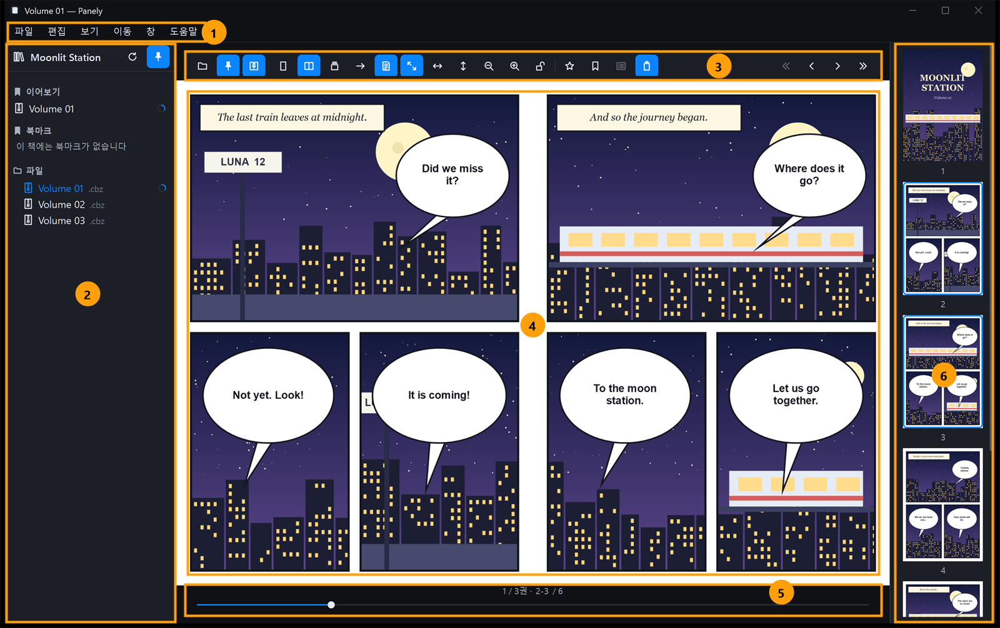</p>

| 번호 | 영역 | 하는 일 |
|---|---|---|
| 1 | 메뉴 막대 | 파일, 편집, 보기, 이동, 창, 도움말. 대부분의 명령이 여기에 있습니다. 전체 화면에서는 숨겨집니다. |
| 2 | 라이브러리 | 이어보기, 즐겨찾기, 북마크, 파일 트리. 기본으로 고정되어 있습니다. |
| 3 | 툴바 | 열기, 고정, 보기 방식, 맞춤·확대, 즐겨찾기·북마크, 썸네일, 번역, 권·페이지 이동 버튼 |
| 4 | 뷰어 | 책 페이지. 드래그로 이동하고, 두 번 클릭해 확대합니다. |
| 5 | 페이지 슬라이더 | 현재 위치(`1 / 3권 · 2-3 / 6`)와 이동 슬라이더 |
| 6 | 썸네일 | 페이지 미리보기. 번역된 페이지에는 체크 배지가 붙습니다. |

**툴바와 슬라이더가 보이는 조건**

- 툴바를 고정하지 않으면, 마우스를 뷰어의 위나 아래 가장자리 근처로 가져갈 때 나타났다가 벗어나면 사라집니다.
- 항상 보이게 하려면 툴바의 고정 버튼이나 **보기 › 툴바 고정**(`Ctrl+Alt+T`)을 쓰세요.
- 책이 열려 있지 않을 때는 툴바가 항상 보입니다.

**툴바 버튼(왼쪽부터)**

1. 열기
2. 라이브러리 고정
3. 툴바 고정
4. 한 장 보기, 두 장 보기, 세로 스크롤
5. 읽기 방향
6. 펼침면 맞추기(표지 한 장 따로). 두 장 보기일 때만 보입니다.
7. 화면에 맞춤, 너비에 맞춤, 높이에 맞춤
8. 축소, 확대
9. 보기 크기 잠금
10. 즐겨찾기, 현재 페이지 북마크, 북마크 목록
11. 썸네일 보기
12. 번역 표시, 언어 선택. 번역 기능을 켰을 때만 보입니다.

오른쪽 끝에는 이전 권, 이전 페이지, 다음 페이지, 다음 권 버튼이 있습니다.

창이 좁아지면 버튼 묶음이 차례로 **맞춤 · 확대/축소**, **페이지 배치**, **더 보기** 메뉴로 접힙니다. 버튼에 마우스를 올리면 이름과 단축키가 표시됩니다.

**라이브러리 고정 해제**

- 라이브러리 고정을 풀면(`Ctrl+Alt+S`) 페이지가 넓어집니다.
- 이때 마우스를 창 왼쪽 가장자리에 잠시 대면 라이브러리가 페이지 위에 겹쳐 나타납니다.
- 벗어나거나 `Esc`를 누르면 닫힙니다.

**썸네일**: 처음에는 숨겨져 있습니다. **보기 › 썸네일 보기**(`Ctrl+Alt+P`)로 엽니다.

**다른 장에서 다루지 않는 메뉴 항목**

| 메뉴 | 항목 |
|---|---|
| **파일** | **진단 로그 지우기**, **진단 로그 폴더 열기**, **압축 해제 캐시 지우기**. 설정의 같은 버튼과 같습니다([8장](#8-설정과-데이터)). 압축 해제 캐시는 책을 여는 중에는 지울 수 없습니다. |
| **편집** | **실행 취소**(`Ctrl+Z`), **실행 복귀**(`Ctrl+Y`), **오려두기**, **복사**, **붙여넣기**, **전체 선택**. 입력 칸(페이지 번호, 말풍선 편집 등)에 커서가 있을 때 그 칸에 적용됩니다. |
| **창** | **리더**(메인 창을 앞으로 가져와 페이지에 포커스), **작업**, **최소화** |
| **도움말** | **Panely에 관하여**: 앱 버전과 빌드, 원본 디자인과 서드파티 구성 요소의 라이선스 |

라이브러리 폴더 변경, 번역 패널의 언어별 메뉴처럼 메뉴 막대에 없는 명령도 있습니다. 각 장에서 설명합니다.

## 3. 책 열기와 라이브러리

### 책 여는 방법

| 방법 | 설명 |
|---|---|
| **파일 › 열기…** (`Ctrl+O`) | 압축 파일(CBZ·CBR·ZIP·RAR)이나 이미지 파일을 고릅니다. 이미지를 고르면 그 이미지가 있는 폴더를 책으로 열고 그 페이지로 갑니다. |
| **파일 › 폴더 열기…** | 이미지가 든 폴더나, 여러 권이 든 시리즈 폴더를 엽니다. |
| 끌어다 놓기 | 파일이나 폴더를 창에 끌어다 놓습니다. 여러 개를 놓으면 첫 번째만 엽니다. |
| 파일 탐색기 | "Panely로 열기"를 추가했다면 탐색기에서 바로 엽니다(아래 참고). |
| 라이브러리 | 파일 트리, 이어보기, 즐겨찾기, 북마크를 클릭합니다. |

Panely는 한 번에 한 창만 띄웁니다. 이미 실행 중일 때 탐색기에서 다른 책을 열면 실행 중인 창에서 열립니다.

책을 여는 동안 뷰어에 로딩 표시가 나옵니다. 큰 압축 파일이 오래 걸리면 로딩 표시의 **취소**를 눌러 여는 것을 멈출 수 있습니다.

### 지원 형식

| 종류 | 확장자 |
|---|---|
| 이미지 | JPEG(`.jpg` `.jpeg`), PNG, WebP, GIF, HEIC/HEIF, BMP, TIFF(`.tif` `.tiff`) |
| 압축 파일 | ZIP·CBZ, RAR·CBR(RAR4, RAR5, solid RAR) |

- 압축 형식은 확장자가 아니라 파일 내용으로 판별합니다. 이름이 `.cbr`이라도 실제로 ZIP이면 엽니다.
- 페이지는 자연 정렬합니다("2"가 "10"보다 앞).
- 숨김 파일, `__MACOSX`, `._`로 시작하는 파일은 건너뜁니다.
- GIF는 첫 프레임만 표시하고, 사진의 EXIF 회전 정보는 반영합니다.
- **암호가 걸린 압축 파일은 지원하지 않습니다.** 열면 "암호가 걸린 압축파일은 지원하지 않습니다."가 표시됩니다.
- 읽을 수 없는 페이지는 "이 페이지를 읽을 수 없습니다." 타일로 표시되고, 나머지 페이지는 계속 읽을 수 있습니다.

### 폴더와 시리즈

- **이미지가 바로 들어 있는 폴더**는 한 권의 책입니다. 하위 폴더는 페이지에 포함되지 않습니다.
- **여러 권이 든 폴더**(하위 폴더나 압축 파일이 2개 이상)는 시리즈로 다룹니다. 폴더를 열면 첫 권을 엽니다.
- 같은 폴더의 다른 권은 앞뒤 권으로 이어집니다.
- 폴더를 열면 그 폴더가 라이브러리의 **파일** 트리 루트가 되고, 다음 실행 때 다시 표시됩니다.
- 책은 열지 않고 트리 루트만 바꾸려면 라이브러리 머리글을 마우스 오른쪽 버튼으로 누르고 **라이브러리 폴더 변경…**을 고릅니다.

**압축 파일 안의 압축 파일**

- 깊이 3단계까지 엽니다. 이때 라이브러리에 **권** 목록이 나타납니다.
- 안전을 위해 압축을 푼 크기는 5GiB, 파일 수는 100,000개까지만 허용합니다.
- 이런 파일과 solid RAR는 압축 해제 캐시에 풀어 둔 뒤 읽습니다([8장](#8-설정과-데이터) 참고).

### 라이브러리 구성

라이브러리에는 위에서부터 다음 항목이 표시됩니다. 내용이 없는 항목은 나타나지 않을 수 있습니다.

| 항목 | 내용 |
|---|---|
| **이어보기** | 다 읽지 않은 책 중 가장 최근에 읽은 한 권. 마우스 오른쪽 버튼 › **이어보기에서 제거**로 읽던 기록을 지웁니다. |
| **권** | 압축 파일 안에 든 여러 권(중첩 압축 파일일 때만) |
| **즐겨찾기** | 즐겨찾기한 책 |
| **북마크** | 지금 책의 페이지 북마크. 없으면 "이 책에는 북마크가 없습니다" |
| **다른 책의 북마크** | 다른 책에 남긴 북마크 |
| **파일** | 라이브러리 폴더의 하위 폴더와 압축 파일 트리 |

**파일 트리**

- 폴더와 압축 파일만 보이고, 이미지 파일은 보이지 않습니다.
- 클릭하면 열리고, 마우스 오른쪽 버튼으로 **이 책 열기**, **탐색기에서 보기**를 쓸 수 있습니다.
- 진행 표시(마우스를 올리면 "N% 읽음"처럼 설명이 나옵니다)
  - 원 모양: 읽은 비율
  - 원 안의 점: 읽는 중이지만 전체 쪽 수를 아직 모르는 책(진행 중)
  - 체크 표시: 다 읽은 책(마지막 펼침까지 읽으면 표시)
- 폴더 내용이 바뀌면 자동으로 새로 고칩니다. 머리글의 새로고침 버튼(**파일 목록 새로고침**)으로 직접 새로 고칠 수도 있습니다.
  - 한꺼번에 너무 많이 바뀌면 "변경이 너무 많아 자동으로 따라갈 수 없습니다…" 안내가 나옵니다. 새로고침 버튼을 누르세요.
- 라이브러리 폴더를 정하지 않았으면 "책을 둘러볼 폴더를 선택하세요." 안내와 **폴더 선택…** 버튼이 나옵니다.

**최근 항목**은 라이브러리가 아니라 **파일 › 최근 항목 열기**에 있습니다.

- 메뉴에는 최근 10권이 보입니다.
- 열 수 없는 책에는 "(사용할 수 없음)"이 붙습니다.
- **메뉴 지우기**로 목록을 비웁니다.

### 즐겨찾기

- **추가와 제거**: 툴바의 별 버튼, **이동 › 즐겨찾기에 추가**(`Ctrl+Shift+D`), 페이지 오른쪽 클릭 메뉴
- 즐겨찾기를 클릭하면 그 책을 읽던 위치에서 엽니다.
- 라이브러리에서 마우스 오른쪽 버튼 › **즐겨찾기에서 제거**로 지웁니다.

### 페이지 북마크

**추가와 제거**

- 툴바의 북마크 버튼, **이동 › 페이지 북마크 추가**(`Ctrl+D`), 페이지 오른쪽 클릭 메뉴를 씁니다.
- 두 장 보기에서는 펼침의 첫 페이지에 북마크가 남습니다.

**이동**

- **이동 › 이전 북마크**(`Ctrl+Shift+[`)와 **다음 북마크**(`Ctrl+Shift+]`)
- **이동 › 북마크** 하위 메뉴, 툴바의 **북마크 목록**, 라이브러리의 북마크 항목
- 다른 책의 북마크는 **이동 › 북마크 › 다른 책**에 있습니다.

**삭제**

- 라이브러리의 북마크 행에 마우스를 올리면 나오는 × 버튼
- 라이브러리의 북마크 행을 마우스 오른쪽 버튼으로 눌러 **북마크 제거** 또는 **이 책의 북마크 삭제…**
- 라이브러리 **북마크** 머리글의 휴지통 버튼(**이 책의 북마크 모두 삭제…**). 지금 책에 북마크가 있을 때만 보입니다.
- **이동 › 이 책의 북마크 모두 삭제…**, **모든 북마크 삭제…**
- 여러 개를 한 번에 지우기 전에는 확인 창이 뜨며, 지운 북마크는 되돌릴 수 없습니다.

**한도**: 책 한 권에 500개, 북마크가 있는 책은 200권까지 보관합니다. 넘으면 가장 오래된 것부터 지워집니다.

### 파일 탐색기의 "Panely로 열기"

**설정 › 일반 › 파일 탐색기**에서 **파일 탐색기에 추가**를 누르면 다음이 바뀝니다.

- CBZ·CBR·ZIP·RAR 파일의 "연결 프로그램" 목록에 Panely가 추가됩니다.
- CBZ·CBR에 기본 앱이 아직 없을 때만 Panely가 기본 앱이 됩니다. ZIP·RAR의 기본 앱은 바꾸지 않습니다.
- 폴더를 마우스 오른쪽 버튼으로 누르면 **Open in Panely** 항목이 생깁니다. 이 항목 이름은 영어로만 표시됩니다.

**파일 탐색기에서 제거**를 누르면 위 등록을 모두 지웁니다. 등록은 현재 사용자 계정에만 적용되므로 관리자 권한이 필요 없습니다.

## 4. 읽기

### 보기 방식

| 방식 | 단축키 | 설명 |
|---|---|---|
| **한 장 보기** | `Ctrl+Shift+1` | 한 번에 한 페이지 |
| **두 장 보기** | `Ctrl+Shift+2` | 두 페이지를 펼쳐서 표시(1-2, 3-4, …) |
| **세로 스크롤** | `Ctrl+Shift+3` | 웹툰처럼 페이지를 세로로 이어 붙여 스크롤 |

보기 방식을 바꿔도 보던 페이지는 유지됩니다.

<p align="center">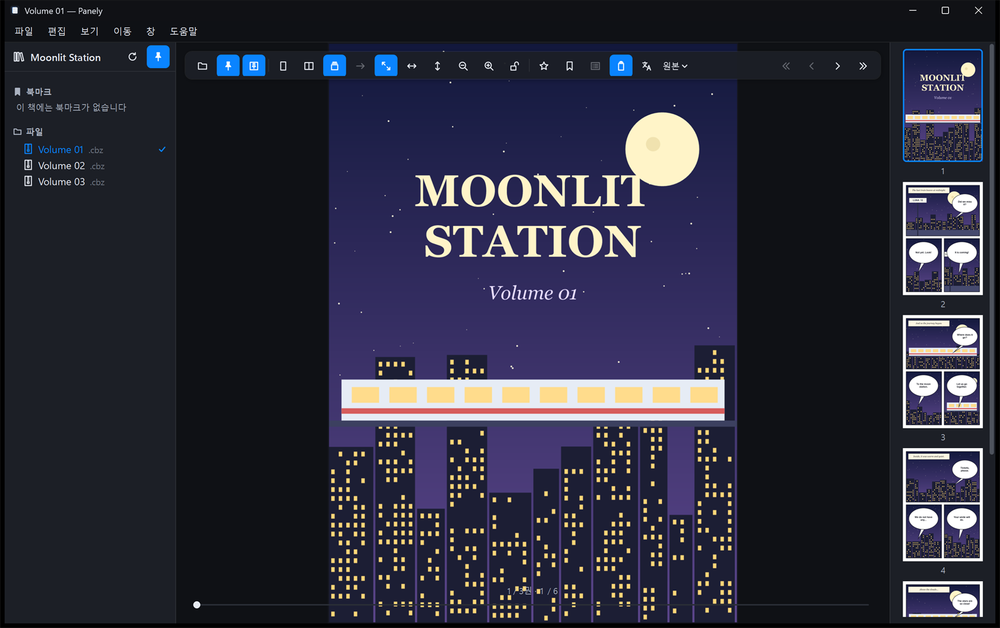</p>

**표지 한 장 따로**

- 두 장 보기에서 툴바의 **펼침면 맞추기(표지 한 장 따로)** 버튼이나 같은 이름의 **보기** 메뉴 항목을 켭니다.
- 켜면 1쪽은 혼자, 그 뒤로 2-3, 4-5쪽처럼 펼쳐집니다.
- 이 설정은 모든 책에 함께 적용됩니다.

### 읽기 방향

망가처럼 오른쪽에서 왼쪽으로 읽는 책은 툴바의 화살표 버튼(→/←)이나 **보기** 메뉴의 읽기 방향 항목으로 방향을 바꿉니다. 오른쪽→왼쪽일 때 메뉴 항목에 체크 표시가 붙습니다.

**오른쪽→왼쪽에서 바뀌는 것**

- 두 장 펼침의 페이지 순서
- `←`/`→` 키의 앞뒤
- 확대한 페이지를 처음 볼 때 보이는 위치(오른쪽 끝부터)

**바뀌지 않는 것**

- 페이지 슬라이더와 툴바의 이전·다음 페이지 버튼
- 세로 스크롤에서는 방향이 왼쪽→오른쪽으로 고정되고 버튼이 비활성화됩니다.

### 맞춤과 확대

| 명령 | 단축키 |
|---|---|
| **화면에 맞춤** | `Ctrl+1` |
| **너비에 맞춤** | `Ctrl+2` |
| **높이에 맞춤** | `Ctrl+3` |
| **확대** / **축소** | `Ctrl++` / `Ctrl+-` |
| **확대/축소 초기화** | `Ctrl+0` |

- 지금과 같은 맞춤을 다시 고르면 확대 배율이 맞춤 크기로 돌아갑니다.
- `Ctrl`+마우스 휠은 마우스 포인터 위치를 기준으로 확대·축소합니다. 정밀 터치패드에서는 두 손가락 핀치도 됩니다.
- 터치스크린에서는 두 손가락으로 벌리거나 오므려 확대·축소하고, 손가락으로 끌어서 페이지를 움직입니다.
- 페이지를 두 번 클릭하면 맞춤 크기와 2배를 오갑니다.
- 확대한 페이지는 마우스로 끌어서 움직입니다. `Shift`+휠, 가로 휠(틸트 휠), 터치패드의 가로 스크롤은 가로로 스크롤합니다.
- 배율은 10%~1000% 사이입니다.

### 보기 크기 잠금

툴바의 자물쇠 버튼이나 **보기 › 보기 크기 고정**(`Ctrl+L`)을 켜면, 창 크기가 바뀌어도 지금 배율을 그대로 둡니다.

- 잠그지 않으면 창 크기가 바뀔 때 페이지를 다시 맞춥니다. 단, 직접 확대해 둔 경우에는 그대로 둡니다.
- 이 버튼은 **설정 › 일반 › 창 크기가 바뀌면 페이지를 다시 맞춤**과 같은 설정을 반대로 켜고 끕니다.

### 시리즈별로 기억하는 것

- 보기 방식, 읽기 방향, 맞춤 방식은 시리즈(권들이 든 폴더)마다 저장됩니다.
- 마지막으로 고른 값은 새 시리즈의 기본값이 됩니다.
- 직접 맞춘 확대 배율은 앱을 실행하는 동안에만 기억합니다.

### 전체 화면

`F11` 또는 **보기 › 전체 화면 시작**을 고릅니다. 메뉴 막대가 숨겨지고, `Esc`나 `F11`로 빠져나옵니다.

## 5. 페이지와 권 이동

### 키보드

| 키 | 동작 |
|---|---|
| `Space`, `→` | 다음 페이지(펼침). 오른쪽→왼쪽 읽기에서는 `←`가 다음 |
| `←` | 이전 페이지. 오른쪽→왼쪽 읽기에서는 `→`가 이전 |
| `Page Down` / `Page Up` | 다음 / 이전 페이지. 세로 스크롤에서는 화면 높이의 90%씩 스크롤 |
| `↓` / `↑` | 세로 스크롤이나 확대한 페이지에서 조금씩 스크롤 |
| `Home` / `End` | 첫 페이지 / 마지막 페이지 |
| `[` / `]` | 이전 권 / 다음 권 |
| `Ctrl+G` | 페이지로 이동 |

라이브러리 트리, 썸네일 목록, 입력 칸에 포커스가 있을 때는 페이지 이동 키가 그 목록이나 칸에서 동작합니다. 페이지를 한 번 클릭한 뒤 쓰세요.

### 마우스 휠

- 한 장·두 장 보기에서는 휠로 페이지를 넘깁니다.
  - 확대해서 페이지가 화면보다 크면, 먼저 스크롤하고 끝에 닿은 다음 한 번 더 굴리면 넘어갑니다.
- 세로 스크롤에서는 휠이 스크롤만 합니다.
- 휠로 넘기지 않으려면 **보기 › 스크롤로 페이지 넘기기 끄기**나 **설정 › 일반 › 스크롤 휠로 페이지 넘기기**를 끕니다.

### 슬라이더, 페이지 번호, 썸네일

- **페이지 슬라이더**: 끌면 바로 그 페이지로 갑니다.
- **슬라이더 위의 페이지 번호**: 클릭하면 입력 칸이 됩니다. 번호를 쓰고 `Enter`를 누르면 이동하고, `Esc`를 누르면 취소합니다.
- **페이지로 이동**(`Ctrl+G`): 페이지 번호를 묻는 창이 뜹니다. 범위를 벗어난 번호는 첫·마지막 페이지로 맞춰집니다.
- **썸네일**: 클릭하면 그 페이지로 갑니다. 지금 보이는 페이지는 파란 테두리로 표시됩니다.

### 페이지 오른쪽 클릭 메뉴

페이지를 마우스 오른쪽 버튼으로 누르면 다음 항목이 나옵니다.

- **페이지 북마크 추가**(또는 **제거**), **즐겨찾기에 추가**(또는 **제거**), **페이지로 이동…**
- **화면에 맞춤**, **너비에 맞춤**, **높이에 맞춤**
- 번역 보조를 켰으면 맨 위에 **이 페이지 다시 번역**, **여기에 말풍선 추가…**, **AI 채팅으로 다듬기…**, **말풍선 편집**이 함께 나옵니다([7장](#7-번역-수정과-내보내기)).

### 이전 권과 다음 권

- **이동 › 이전 권** / **다음 권**(`[` / `]`)이나 툴바 오른쪽 끝의 « » 버튼으로 같은 폴더의 앞뒤 권으로 갑니다.
- 폴더의 첫 권이나 마지막 권이면 그렇다고 알려 줍니다.

**권 끝에서 넘기기**

- 마지막 펼침에 닿으면 아래에 **다음 권** 카드가 나타납니다.
- 한 번 더 넘기거나(`Space`, 방향키, 휠) **열기**를 누르면 다음 권을 첫 페이지부터 엽니다.
- **처음부터 다시 읽기**를 누르면 이 책의 다 읽음 표시를 지우고 1쪽으로 돌아갑니다.

<p align="center">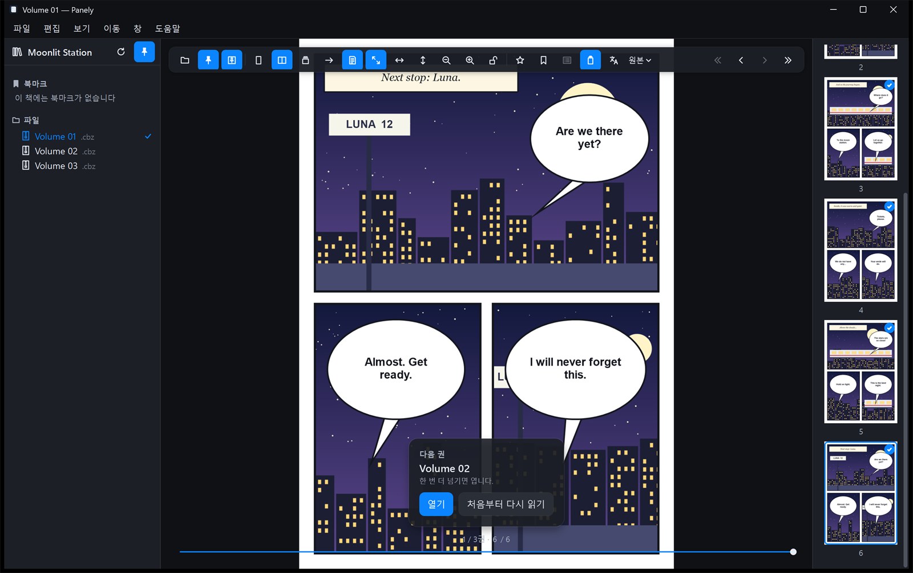</p>

**첫 펼침에서 뒤로 가기**

- 첫 펼침에서 뒤로 가면 위쪽에 **이전 권** 카드가 나타납니다.
- 한 번 더 뒤로 가면 이전 권을 읽던 위치에서 엽니다.

> [!NOTE]
> 세로 스크롤에서는 휠이 다음 권으로 넘어가지 않습니다. `Space`나 방향키를 쓰세요. 툴바의 이전·다음 페이지 버튼(‹ ›)도 다른 권으로 넘어가지 않습니다.

### 읽던 위치 복원

- 페이지를 넘길 때마다 위치가 저장되고, 책을 다시 열면 그 위치에서 시작합니다.
- 앱을 다시 실행하면 마지막 라이브러리 폴더만 복원하고 책은 자동으로 열지 않습니다. **이어보기**를 클릭하세요.
- **파일 › 책 다시 불러오기**(`Ctrl+R`)는 보던 페이지를 유지한 채 책을 다시 읽어 들입니다.
- 열려 있는 책 파일이 바뀌면 "디스크에서 이 책이 변경되었습니다." 배너가 뜹니다. **다시 불러오기**를 누르면 반영됩니다.

## 6. 번역 시작하기

번역은 실험 기능입니다. 말풍선을 찾고, 글자를 읽고, 기계 번역을 페이지 위에 그립니다.

- 모든 처리는 PC 안에서 이뤄집니다. 언어팩을 받을 때 말고는 네트워크를 쓰지 않습니다.
- 내용 이해를 돕는 용도이며, 정식 번역을 대신하지 않습니다.
- **지원 언어**: 일본어, 중국어(간체), 중국어(번체), 한국어, 영어. 이 다섯 언어 사이에서 원문과 번역 언어를 자유롭게 고를 수 있습니다(중국어 간체↔번체 포함).

<p align="center"></p>

### 1단계: 번역 기능 켜기

**파일 › 설정…**(`Ctrl+,`)을 열고 **실험적 기능** 탭에서 **번역 보조** 스위치를 켭니다. 켜면 다음 항목이 나타납니다.

- 툴바: 번역 버튼, 언어 선택 버튼
- **보기** 메뉴: 번역 항목
- **파일 › 번역본 내보내기…**
- **창 › 작업**

<p align="center">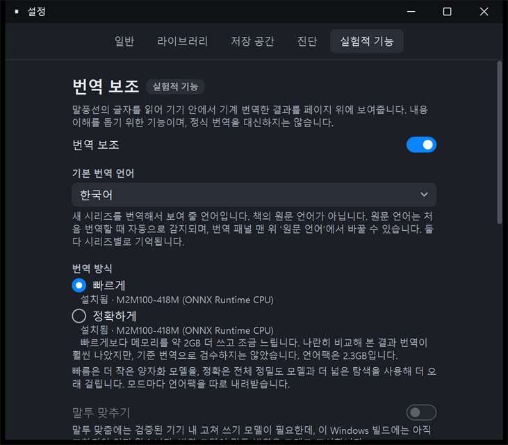</p>

이 탭의 다른 항목은 다음과 같습니다.

- **기본 번역 언어**: 새 시리즈를 어느 언어로 번역할지 고릅니다. 시리즈마다 따로 바꿀 수 있습니다.
- **번역 모델**: 번역은 Gemma 4 E2B 모델 하나로 합니다. 말풍선 몇 개를 바로 앞 대사와 함께 번역해 인물마다 말투(존댓말·반말)와 이름을 이어 갑니다. 설치되어 있으면 실제로 쓰는 장치(Vulkan GPU 이름 또는 CPU)가 함께 표시됩니다. 장치는 첫 번역 때 정해집니다.

### 2단계: 언어팩 내려받기

번역에는 아래 모델(언어팩)이 필요합니다. 모델은 고정된 버전을 Hugging Face에서 받고, 설치 전에 SHA-256 체크섬을 확인합니다. Panely가 모델을 함께 배포하지는 않습니다.

| 언어팩 | 크기 | 필요한 경우 |
|---|---|---|
| 말풍선 탐지 (RT-DETR) | 160.7 MB | 항상 |
| 중국어·영어·한국어 글자 인식, 언어 감지 (PP-OCRv5) | 40.9 MB | 항상 |
| 일본어 글자 인식 (manga-ocr) | 111.4 MB | 일본어 책 |
| 번역 (Gemma 4 E2B) | 3.1 GB | 항상 |

합계는 일본어 책이 약 3.4GB, 그 밖의 언어가 약 3.3GB입니다.

이전 버전에서 받은 번역 팩(빠르게·정확하게, M2M100)은 이제 쓰지 않으므로 앱을 시작할 때 자동으로 지웁니다.

**받는 방법**

- **번역 패널**(아래 3단계)의 **언어팩 다운로드…** 버튼: 필요한 팩을 모두 차례로 받고, 끝나면 바로 번역을 시작합니다.
- **설정 › 실험적 기능 › 언어팩**: 팩마다 **다운로드…** 버튼이 있습니다. 받기만 하고 번역은 시작하지 않습니다.

<p align="center">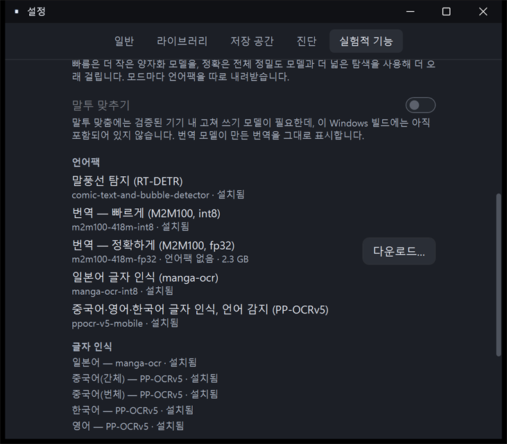</p>

받는 동안 번역 패널에 지금 받는 팩과 전체 크기(예: "번역 (Gemma 4 E2B) 받는 중 · 1.1 GB / 3.1 GB")와 진행 막대가 보입니다. 패널을 닫아도 뷰어 아래쪽에 "언어팩 받는 중 · 1.1 GB / 3.1 GB"가 표시됩니다. 개발 PC에서 번역 팩(3.1GB)을 받는 데 약 2분 걸렸습니다(네트워크 속도에 따라 다릅니다).

언어팩이 없어 멈춰 있던 번역은 다 받으면 앱을 다시 시작하지 않아도 저절로 이어집니다(번역 패널에서 받든 설정에서 받든 같습니다).

언어팩은 `%LOCALAPPDATA%\Panely\Models`에 저장됩니다. 한 번 받으면 네트워크 없이 번역합니다.

**글자 인식 상태**: **설정 › 실험적 기능 › 글자 인식**에 언어마다 쓰는 글자 인식 엔진이 표시됩니다(예: "일본어 — manga-ocr · 설치됨").

- 그 언어의 글자 인식 언어팩이 없고 Windows에 그 언어의 글자 인식(OCR) 기능이 설치되어 있으면, 대신 Windows 글자 인식을 씁니다. 이때는 "Windows OCR(대체)"로 표시됩니다.
- Windows 글자 인식은 가로 줄만 잘 읽습니다. 일본어·중국어 세로쓰기 대사는 읽지 못해 번역되지 않을 수 있으므로, 언어팩을 받는 편이 좋습니다.
- 책의 언어를 읽을 방법이 없으면 번역 패널에 **Windows 언어 설정 열기**와 **다시 확인** 버튼이 나옵니다. Windows 설정 › 시간 및 언어 › 언어 및 지역에서 그 언어를(광학 문자 인식 기능과 함께) 추가한 뒤 **다시 확인**을 누르세요.

> [!NOTE]
> 다운로드는 중간에 취소할 수 없고, 앱 안에는 언어팩을 지우는 버튼이 없습니다. 받는 도중에 앱을 닫으면 다음에 처음부터 다시 받습니다.

### 3단계: 번역 패널에서 언어 고르고 시작하기

툴바의 **언어 선택** 버튼(언어 이름과 ▾)을 누르고 **번역 패널…**을 고릅니다. 아직 번역한 적이 없는 책이면 툴바의 번역 버튼을 눌러도 패널이 열립니다.

<p align="center">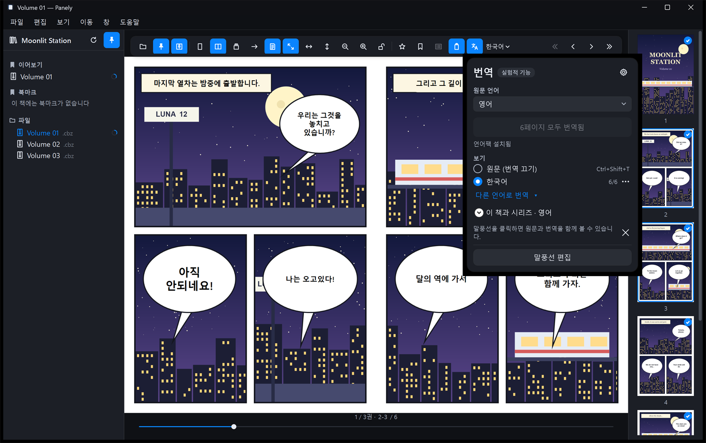</p>

1. **원문 언어**: 책의 언어입니다.
   - **자동 감지**로 두면 번역을 시작할 때 현재 페이지부터 최대 15쪽을 읽어 감지합니다.
   - 감지한 언어는 시리즈별로 기억합니다.
   - 언어팩이 없으면 언어를 감지할 수 없어 먼저 **언어팩 다운로드…**가 나옵니다. 받고 나면 감지부터 이어서 진행합니다.
2. **번역할 언어**: 시리즈에 저장된 언어를 씁니다. 저장된 언어가 없으면 **기본 번역 언어**를 쓰고, 그것도 없으면 앱 언어를 씁니다.
   - 다른 언어로 번역하려면 **언어 선택 › 다른 언어로 번역**이나 패널의 **다른 언어로 번역**을 고릅니다.
3. **이 책을 한국어로 번역** 버튼을 누릅니다. 언어팩이 없으면 이 자리에 **언어팩 다운로드…**가 나옵니다.
   - **보기 › 이 책 번역하기**(`Ctrl+Alt+Y`)로도 시작합니다.
   - 같은 버튼과 메뉴로 일시정지하거나 이어서 번역합니다.

**번역이 진행되는 방식**

- 현재 페이지부터 책 끝까지 번역한 뒤, 앞쪽 페이지를 번역합니다.
- 번역된 말풍선은 차례로 페이지에 나타납니다. 진행 상황은 패널과 뷰어 아래쪽 진행 표시에 나오며, 진행 표시를 누르면 작업 창이 열립니다.
- 한 번에 한 작업만 실행합니다. 다른 책의 작업은 순서를 기다립니다.
- 번역을 마친 페이지의 썸네일에는 체크 배지가 붙습니다.
- 번역을 시작하면 말풍선을 찾는 동안 번역 모델도 함께 준비합니다. GPU에서는 처음 준비에 20초가량 걸리지만 말풍선 탐지와 겹쳐 돌아, 첫 번역은 보통 10초 안팎에 나타납니다.

### GPU가 없는 PC에서는

번역 모델은 GPU가 있으면 GPU(Vulkan)로, 없으면 CPU로 돕니다. CPU로 돌 때는 훨씬 느립니다.

| 장치 | 말풍선 하나 번역 | 298쪽 웹툰(말풍선 146개) 전체 | 첫 번역 표시 |
|---|---|---|---|
| GPU (RTX 4070 Ti SUPER) | 약 0.1초 | 약 58초 | 약 10초 |
| CPU만 (Core i7-13700K, 탐지·인식·번역 모두 CPU) | 약 0.6초 | 약 325초(5분 25초) | 약 15초 |

- 개발 PC에서 한 번 잰 값입니다. CPU가 느리거나 코어가 적은 PC, 노트북 절전 모드에서는 더 오래 걸립니다.
- GPU가 아예 없거나 GPU를 끈 경우에는 말풍선 탐지도 CPU로 돌므로, 책 전체 시간에는 말풍선 수뿐 아니라 쪽 수도 크게 영향을 줍니다. Vulkan만 안 되는 GPU라면 말풍선 탐지는 GPU(DirectX 12)를 그대로 써서 표보다 빠를 수 있습니다.
- 다음과 같은 경우 CPU로 돕니다.
  - GPU가 없는 PC
  - Vulkan 드라이버가 없는 오래된 GPU
  - ARM 기반 Windows(이 빌드에는 ARM용 Vulkan 실행 파일이 없습니다)
  - `PANELY_ORT_DEVICE=cpu`로 GPU를 끈 경우
- 지금 어느 장치로 도는지는 **설정 › 실험적 기능 › 번역 모델**에서 확인할 수 있습니다(첫 번역 뒤).
- CPU로 돌 때는 한 번에 많은 쪽을 번역하기보다, 읽는 동안 현재 쪽부터 번역되게 두는 편이 편합니다. 번역은 현재 페이지부터 순서대로 진행됩니다.

### 원문과 번역 전환

- **전환하는 방법**: 툴바의 번역 버튼, **보기 › 번역 표시** / **번역 숨기기**(`Ctrl+Shift+T`), 패널의 **원문 (번역 끄기)**
- 이 전환은 모든 책에 함께 적용됩니다.
- 여러 언어로 번역했다면 **언어 선택** 메뉴나 번역 패널에서 볼 언어를 고릅니다. 언어마다 번역한 쪽 수가 함께 표시됩니다.
- 번역 패널의 언어 줄 오른쪽 **⋯** 버튼(이 언어의 번역 시작·일시정지·중지)으로 언어마다 따로 조작합니다.
  - **번역**(처음) / **계속**(멈춘 뒤) / **일시정지**(번역 중): 보는 언어를 바꾸지 않고 그 언어의 번역만 시작하거나 멈춥니다.
  - **이 언어로 보기**: 그 언어의 번역을 표시합니다.
  - **중지**: 그 언어의 번역 작업을 멈추고 목록에서 뺍니다. 번역을 마친 페이지는 남습니다.
- 번역 패널 오른쪽 위의 톱니바퀴 버튼(**번역 설정**)에는 **기본 번역 언어**(설정의 같은 항목)와 **작업**(작업 창 열기)이 있습니다.
- 아직 번역하지 않은 페이지는 원문 그대로 보입니다.
- 모델이 번역하지 못한 말풍선은 원문을 그대로 보여 줍니다. 그 말풍선을 클릭하면 이유가 표시됩니다.

> [!NOTE]
> 세로 스크롤과 한 장·두 장 보기는 번역 결과를 따로 저장합니다. 그래서 보기 방식을 바꾸면 그 방식으로 다시 번역해야 할 수 있습니다. 이전 버전(M2M100)에서 번역한 결과는 쓰지 않으므로 다시 번역해야 합니다. 직접 고친 내용은 남습니다.

### 시리즈 전체 번역

패널의 **이 책과 시리즈**를 펼칩니다.

- **이 시리즈 자동 번역**: 이 책을 먼저 번역하고, 같은 시리즈의 다른 권을 백그라운드에서 이어서 번역합니다.
- **시리즈 전체 번역 (N권)**: 시리즈의 모든 권을 작업에 넣습니다. 압축 파일 안의 압축 파일로 된 권은 건너뛰므로 하나씩 열어서 번역하세요.

## 7. 번역 수정과 내보내기

### 말풍선 하나 보기

번역이 보일 때 말풍선을 클릭하면 팝오버에 원문과 번역이 함께 나옵니다. 이미 다른 언어로도 번역했다면 그 번역도 함께 보입니다.

### 말풍선 편집

기계 번역이 틀렸거나, 글자를 잘못 읽었거나, 말풍선을 아예 찾지 못한 곳을 직접 바로잡는 모드입니다.

**편집 모드 켜고 끄기**

- **켜기**: **보기 › 말풍선 편집**(`Ctrl+Shift+E`), 패널의 **말풍선 편집**, 페이지 오른쪽 클릭 메뉴의 **말풍선 편집**
- **끄기**: 편집 막대의 **완료**, `Esc`, 같은 메뉴의 **말풍선 편집 완료**
- 번역을 보고 있고 이 책에 번역된 페이지가 한 쪽 이상 있을 때만 켤 수 있습니다.

<p align="center">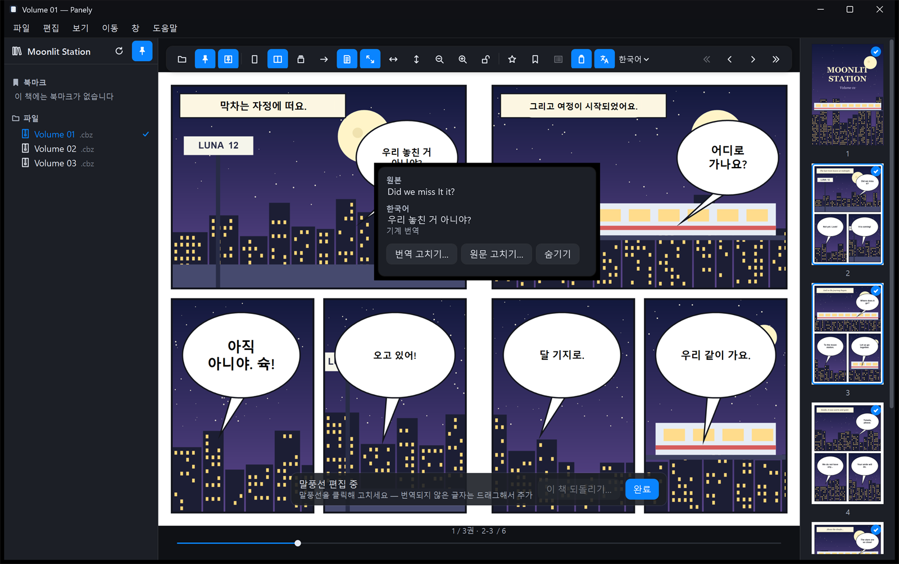</p>

**편집 모드의 화면**

- 아래쪽에 **편집 막대**가 나타납니다. 제목 옆에 이 책에서 고친 말풍선 수와 숨긴 말풍선 수가 표시됩니다(예: "말풍선 편집 중 · 고친 말풍선 2개 · 숨김 1개").
- 고치거나 직접 추가한 말풍선에는 오른쪽 위에 연필 배지가 붙습니다.
- 직접 추가한 말풍선은 실선 테두리로, 숨긴 말풍선과 글자가 없는 추가 말풍선은 점선 테두리로 보입니다.
- 편집 모드가 아닐 때는 테두리와 배지가 보이지 않고, 숨긴 말풍선은 클릭할 수 없습니다.

#### 말풍선 고치기

말풍선을 클릭하면 팝오버가 열립니다.

- **원본**: 지금 쓰는 원문입니다. 원문을 고쳤다면 아래에 "인식된 원문: …"으로 처음 읽은 글자가 함께 나옵니다.
- **번역**(예: 한국어): 지금 보이는 언어의 번역과 그 상태입니다. 다른 언어로도 번역했다면 그 번역도 아래에 나옵니다.
- 원문과 번역 글자는 끌어서 선택하고 복사할 수 있습니다.

| 버튼 | 하는 일 |
|---|---|
| **번역 고치기…** | 번역을 직접 고칩니다. |
| **원문 고치기…** | 잘못 읽은 원문을 고칩니다. 고친 원문으로 다시 기계 번역합니다. |
| **숨기기** | 실제로는 글자가 없는 곳을 숨깁니다. 6초 동안 **실행 취소**가 나타납니다. |
| **이 말풍선 다시 보이기** | 숨긴 말풍선에만 나타납니다. |
| **지우기** | 직접 추가한 말풍선에만 나타납니다. 그 말풍선을 지웁니다. |
| **원래대로** ▸ | 고친 말풍선에만 나타납니다. **기계 번역 사용**(번역만), **원문 되돌리기**(인식한 원문과 그 기계 번역으로), **둘 다 되돌리기** |

말풍선을 마우스 오른쪽 버튼으로 눌러도 같은 작업이 메뉴로 나옵니다(**이 말풍선 숨기기**, **이 말풍선 지우기** 등). 편집 모드가 아니어도 팝오버와 오른쪽 클릭 메뉴로 고칠 수 있습니다.

**입력 칸에서**

- `Enter`는 저장, `Shift+Enter`(또는 `Ctrl+Enter`, `Alt+Enter`)는 줄바꿈, `Esc`는 취소입니다.
- 한글을 조합하는 중에 누른 `Enter`는 글자를 확정할 뿐 저장하지 않습니다.

**원문을 고치면**

- 고친 원문을 지금 보이는 언어와, 이 책을 이미 번역해 둔 다른 언어로 모두 다시 번역합니다. 번역하는 동안 팝오버에는 "번역 중…"이 표시됩니다.
- 직접 고친 번역은 덮어쓰지 않습니다. 고친 원문의 기계 번역을 보려면 **원래대로 › 기계 번역 사용**을 고르세요.

**팝오버의 번역 상태 표시**

| 표시 | 뜻 |
|---|---|
| 기계 번역 | 손대지 않은 기계 번역 |
| 직접 고친 번역 | **번역 고치기**나 AI 채팅으로 바꾼 번역 |
| 고친 원문의 기계 번역 | **원문 고치기** 뒤 다시 번역한 결과 |
| 원문을 고쳤지만 아직 다시 번역하지 않음 | 다시 번역을 기다리는 중 |
| 이 말풍선은 번역하지 못해 원문을 그대로 보여 줍니다… | 모델이 번역하지 못한 말풍선. **번역 고치기**로 직접 입력할 수 있습니다. |
| 직접 추가한 말풍선 — 그 글자의 기계 번역 | 추가한 말풍선의 번역 |
| 직접 추가한 말풍선 — 읽힌 글자가 없음… | 추가했지만 글자를 읽지 못한 말풍선 |
| 직접 추가한 말풍선 — 아직 이 언어로 번역되지 않음 | 다른 언어로 볼 때 추가한 말풍선 |

#### 인식되지 않은 글자에 말풍선 추가하기

말풍선 탐지가 놓친 글자(표지판, 손글씨, 말풍선 밖 대사, 작은 글자 등)는 번역되지 않고 원문 그대로 남습니다. 이런 글자는 직접 영역을 지정하면 Panely가 그 영역만 다시 읽고(글자 인식) 번역해서 페이지에 그려 줍니다.

<p align="center">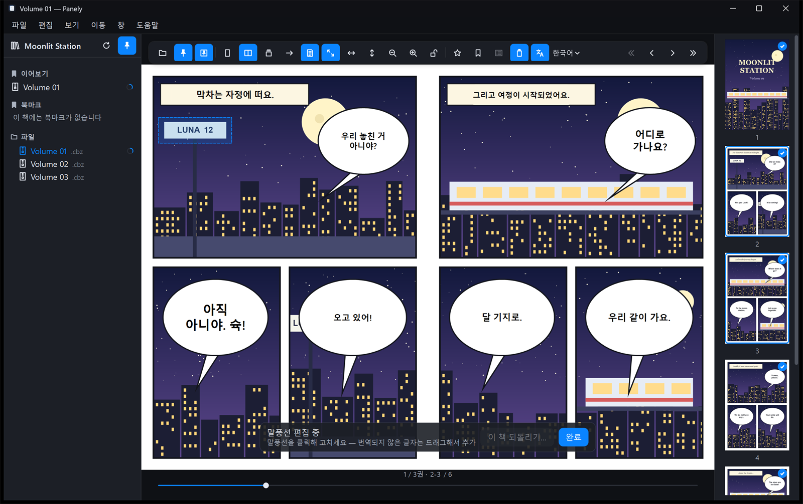</p>

1. 편집 모드를 켭니다.
2. 번역되지 않은 글자를 넉넉히 감싸도록 마우스로 끌어 사각형을 그립니다. 끄는 동안 점선 사각형이 보입니다.
   - 이미 있는 말풍선 위에서 시작하면 끌기 대신 그 말풍선의 팝오버가 열립니다. 말풍선이 없는 곳에서 시작하세요.
   - 너무 작은 사각형(가로나 세로가 원본 이미지 기준 8픽셀 미만)은 무시합니다.
3. 마우스 버튼을 놓으면 Panely가 그 영역의 글자를 책의 원문 언어로 읽고, 지금 보이는 언어로 번역합니다.
   - 번역이 끝나면 "말풍선을 추가했습니다. 지금 번역 중이며, 클릭하면 글자를 고치거나 지울 수 있습니다." 알림이 잠깐 나오고, 그 자리에 번역이 그려집니다.
   - 배경색과 세로쓰기 여부도 그 영역에서 알아내 다른 말풍선과 같은 방식으로 그립니다.
4. 추가한 말풍선은 실선 테두리와 연필 배지로 표시됩니다. 클릭하면 읽은 원문과 번역을 확인하고, **번역 고치기…**, **원문 고치기…**, **지우기**를 할 수 있습니다.

<p align="center">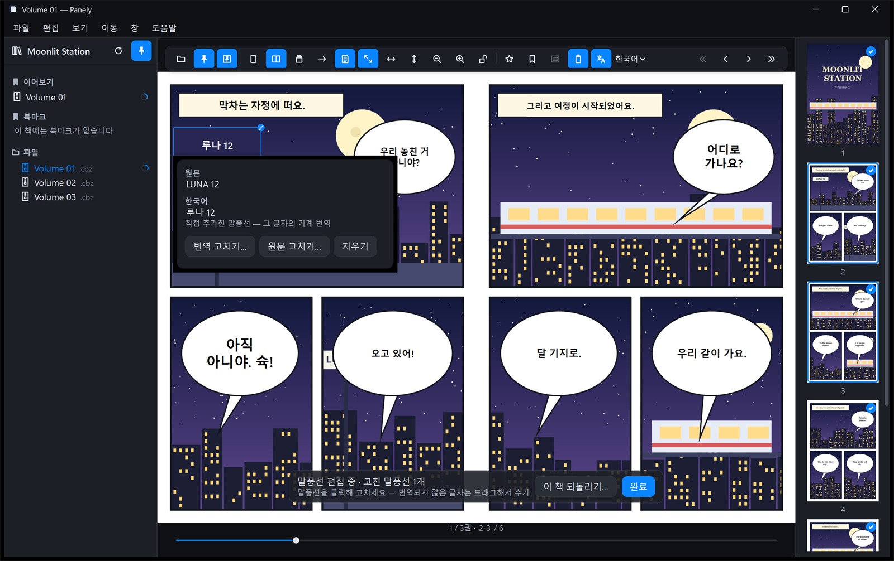</p>

**글자를 읽지 못했을 때**

- 영역 안에서 글자를 찾지 못하면 빈 말풍선(점선 테두리)만 추가되고, "말풍선을 추가했지만 그 자리에서 읽을 수 있는 글자가 없었습니다…" 알림이 나옵니다.
- 점선 테두리를 클릭하고 **원문 고치기…**로 원문을 직접 입력하면 그 원문을 번역합니다.
- 일부만 읽혔거나 잘못 읽혔다면 같은 방법으로 **원문 고치기…**에서 바로잡습니다.
- 지정한 영역에서는 글자 없이 숫자만 있는 조각(예: 표지판 "LUNA 12"의 "12")도 버리지 않고, 같은 줄의 조각은 읽는 순서대로 이어 붙입니다.
- 원문 언어를 아직 모를 때(자동 감지 전)나 그 언어의 글자 인식 언어팩이 없을 때는 글자를 읽지 않고 빈 말풍선으로 추가합니다.

**오른쪽 클릭으로 추가하기**

- 페이지를 마우스 오른쪽 버튼으로 눌러 **여기에 말풍선 추가…**를 고르면, 누른 자리를 가운데로 일정한 크기(페이지 너비의 약 18%×12%)의 영역을 잡아 같은 방식으로 읽고 번역합니다.
- 편집 모드가 아니어도 고를 수 있으며, 고르면 편집 모드가 켜집니다.
- 영역 크기를 고를 수 없으므로, 글자 크기에 맞춰 정확히 잡으려면 끌어서 추가하는 편이 낫습니다.

**추가한 말풍선은**

- 직접 고친 내용과 함께 저장되므로 번역 캐시를 지우거나 다시 번역해도 남습니다.
- 번역본 내보내기와 AI 채팅으로 다듬기에도 포함됩니다.
- 다른 언어로 번역을 바꾸면 "아직 이 언어로 번역되지 않음"으로 표시됩니다. **원문 고치기…**에서 저장하면 그 언어로도 번역합니다.
- 보기 방식별로 따로 저장됩니다. 한 장·두 장 보기에서 추가한 말풍선은 세로 스크롤에서는 보이지 않습니다(그 반대도 같습니다).

#### 숨긴 말풍선과 책 되돌리기

- **숨긴 말풍선**: 편집 모드에서 점선으로 보입니다. 클릭해서 **이 말풍선 다시 보이기**를 누르면 다시 나타납니다.
- **숨긴 말풍선 모두 보이기**(편집 막대, 숨긴 말풍선이 있을 때만) 또는 **보기 › 숨긴 말풍선 보기**: 이 책에서 숨긴 말풍선을 모두 다시 보이게 합니다.
- **이 책 되돌리기…**(편집 막대): 확인 창("이 책에서 고친 말풍선 N개를 모두 되돌릴까요?")을 거쳐, 이 책에서 고치거나 숨기거나 추가한 말풍선을 모두 지우고 기계 번역으로 되돌립니다. 다른 책의 수정은 그대로입니다.

#### 다시 번역하기

- **이 페이지 다시 번역**: 페이지 오른쪽 클릭 메뉴나 **언어 선택** 메뉴에 있습니다. 화면의 페이지를 다시 읽고 번역합니다. 둘로 나뉘어 있던 말풍선은 하나로 합쳐질 수 있습니다.
- **이 책 다시 번역…**: 패널의 **이 책과 시리즈**에 있습니다.
- 직접 고친 내용은 번역 캐시와 따로 저장되므로, 캐시를 지우거나 다시 번역해도 유지됩니다. 다만 다시 번역해서 말풍선 위치가 달라지면, 그 말풍선에 했던 수정이 더 이상 적용되지 않을 수 있습니다.
- 고친 내용을 모두 지우려면 **설정 › 실험적 기능 › 고친 내용 모두 삭제…**를 씁니다.

### AI 채팅으로 다듬기

번역 모델은 바로 앞 대사 몇 줄만 보고 번역하므로, 책 전체에 걸친 인물 관계나 앞에서 정한 이름을 놓칠 수 있습니다. 이미 쓰고 있는 AI 채팅(ChatGPT, Claude, Gemini 등)에 책 전체의 대사를 텍스트 파일로 넘겨 다듬을 수 있습니다.

**언어 선택 › AI 채팅으로 다듬기…**(페이지 오른쪽 클릭 메뉴와 패널에도 있음)를 엽니다.

<p align="center">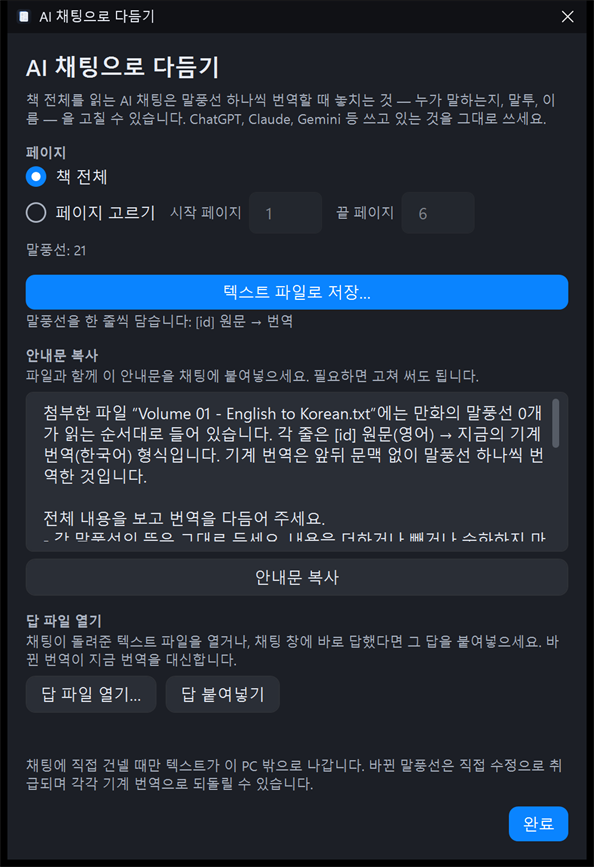</p>

1. **페이지**: **책 전체**나 **페이지 고르기**(시작·끝 페이지)를 고릅니다.
2. **텍스트 파일로 저장…**을 누릅니다.
   - 파일에는 말풍선이 한 줄씩 `[p12-3] 원문 → 번역` 형식으로 들어갑니다.
   - 숨긴 말풍선과 번역이 없는 말풍선은 빠집니다.
3. **안내문 복사**를 누르고, 저장한 파일을 첨부한 새 채팅에 안내문을 붙여넣습니다. 안내문은 고쳐 써도 됩니다.
4. 채팅의 답을 가져옵니다.
   - 답이 파일이면 **답 파일 열기…**를 누릅니다.
   - 채팅 창에 바로 답했다면 답 전체를 복사한 뒤 **답 붙여넣기**를 누릅니다.
5. 바뀐 번역만 적용되고, 결과(바뀐 수, 그대로인 수, 돌아오지 않은 말풍선)가 표시됩니다.
   - 돌아오지 않은 말풍선이 있으면 그 부분만 다시 요청하거나 페이지 범위를 줄이세요.
   - **이 답 되돌리기**를 누르면 이번 답으로 바뀐 번역을 되돌립니다.

적용한 번역은 "직접 고친 번역"으로 저장됩니다. 말풍선마다 **원래대로 › 기계 번역 사용**으로 되돌릴 수 있습니다.

> [!NOTE]
> 텍스트는 사용자가 채팅에 직접 건넬 때만 PC 밖으로 나갑니다. Panely는 채팅 서비스에 연결하지 않습니다.

### 번역본 내보내기

번역을 입힌 책을 새 파일로 저장합니다. 원본 파일은 바뀌지 않습니다.

**여는 곳**

- **파일 › 번역본 내보내기…**
- **언어 선택** 메뉴
- 패널의 **이 책과 시리즈**
- 라이브러리의 책·폴더 오른쪽 클릭 메뉴

<p align="center">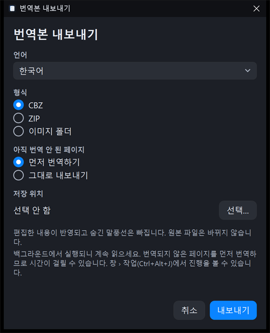</p>

| 항목 | 선택지 |
|---|---|
| **언어** | 내보낼 번역 언어 |
| **형식** | CBZ, ZIP, 이미지 폴더 |
| **아직 번역 안 된 페이지** | **먼저 번역하기**(기본) 또는 **그대로 내보내기** |
| **저장 위치** | **선택…**으로 폴더를 고릅니다. |

**내보낸 파일에 들어가는 것**

- 책의 모든 페이지가 들어갑니다.
  - 번역된 페이지: 번역을 그려 넣은 이미지. PNG는 PNG로, 나머지는 JPEG(품질 92)로 저장됩니다.
  - 번역이 없는 페이지: 원본 그대로
- 직접 고친 내용은 반영되고, 숨긴 말풍선은 빠집니다.
- 파일 이름은 `<책 제목> [한국어].cbz` 형식입니다. 언어 이름은 앱 언어를 따릅니다.
- 같은 이름이 있으면 " 2", " 3"을 붙여 새로 만들고, 기존 파일을 덮어쓰지 않습니다.
- 고른 형식, 아직 번역 안 된 페이지 처리 방식, 저장 위치는 다음 내보내기 때 그대로 기억합니다.

**시리즈 전체 내보내기**

- 패널의 **이 책과 시리즈**에 있는 **시리즈 번역본 내보내기 (N권)…**, 또는 라이브러리에서 여러 권이 든 폴더를 마우스 오른쪽 버튼으로 눌러 같은 항목을 고릅니다. 시리즈에 두 권 이상 있을 때만 보입니다.
- 창 제목이 **시리즈 번역본 내보내기**로 바뀌고, 내보낼 권 목록이 위에 표시됩니다. 선택 항목은 한 권 내보내기와 같습니다.
- 권마다 따로 파일(또는 폴더)을 만들고, 아직 번역하지 않은 권은 먼저 번역합니다(**먼저 번역하기**일 때).
- 압축 파일 안에 든 권은 그 압축 파일이 열려 있는 동안에만 내보낼 수 있습니다. 내보내기가 끝날 때까지 책을 열어 두세요.

**진행 방식**

- 내보내기는 백그라운드에서 실행되므로 계속 읽을 수 있습니다.
- 진행은 **창 › 작업**(`Ctrl+Alt+J`)에서 봅니다.
- 쓰는 도중에는 `.partial` 임시 파일을 쓰고, 다 쓰면 이름을 바꿉니다.

### 작업 창

**창 › 작업**(`Ctrl+Alt+J`), **언어 선택 › 작업**, 번역 패널의 톱니바퀴 메뉴, 또는 뷰어 아래쪽 진행 표시를 눌러 엽니다. 진행 표시에는 지금 책뿐 아니라 다른 책의 번역과 내보내기 진행·완료·실패도 나옵니다.

<p align="center">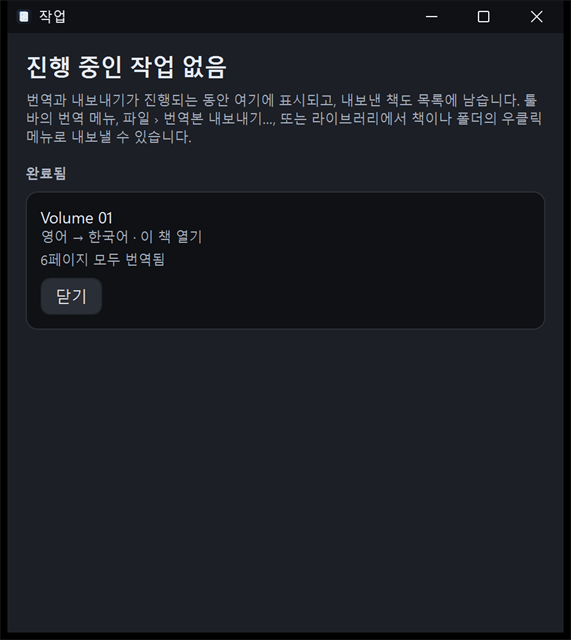</p>

| 구역 | 내용 |
|---|---|
| **번역** | 실행·대기·일시정지·실패한 번역 작업 |
| **내보내기** | 실행 중이거나 실패·취소된 내보내기 |
| **완료됨** | 이번 실행에서 끝난 번역 |
| **내보낸 책** | 내보낸 파일 기록(최대 50개). **목록 지우기**는 기록만 지우고 파일은 남깁니다. |

작업 상태에 따라 다음 버튼이 나옵니다.

- **번역 작업**: **일시정지**, **계속**(실패했으면 **다시 시도**), **중지**(끝났거나 실패했으면 **닫기**). 지금 열려 있지 않은 책의 작업에는 **이 책 열기**도 있습니다.
- **내보내기**: 진행 중이면 **내보내기 취소**, 실패·취소되었으면 **다시 시도**와 **닫기**
- **내보낸 책**: **열기**, **탐색기에서 보기**

**앱을 종료하면**

- 번역이나 내보내기가 진행 중이면 "Panely를 종료할까요?" 확인 창이 뜹니다.
- 종료하면 작업 목록은 사라집니다.
- **남는 것**
  - 번역을 마친 페이지
  - 직접 고친 내용
  - 내보낸 책 기록
  - 시리즈별 번역 설정
- 다시 실행해서 같은 책을 번역하면 이미 번역한 페이지는 건너뛰고 이어서 번역합니다. **이 시리즈 자동 번역**을 켠 시리즈는 책을 열면 자동으로 다시 시작합니다.

## 8. 설정과 데이터

**파일 › 설정…**(`Ctrl+,`)을 엽니다. 바꾼 내용은 바로 저장되고, `Esc`로 창을 닫습니다.

<p align="center">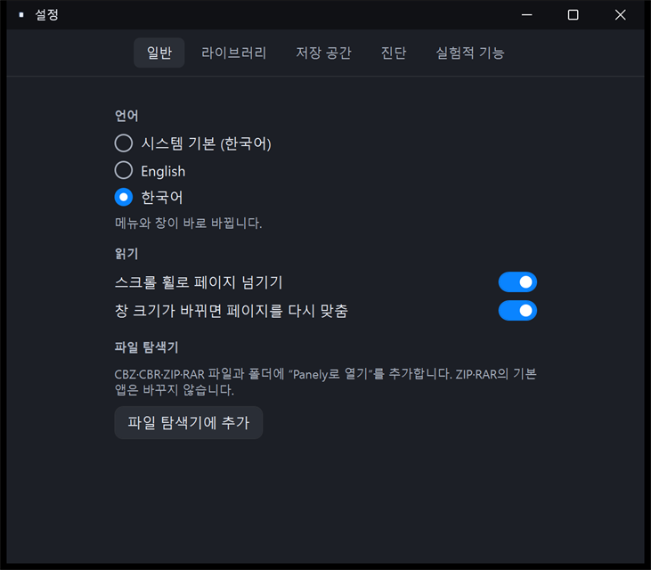</p>

| 탭 | 항목 |
|---|---|
| **일반** | **언어**(시스템 기본, English, 한국어. 바로 바뀜) · 스크롤 휠로 페이지 넘기기 · 창 크기가 바뀌면 페이지를 다시 맞춤 · 파일 탐색기 등록 |
| **라이브러리** | 실행 시 마지막 폴더 다시 열기 · 마지막으로 연 폴더와 **지금 잊기** · 파일 트리 자동 새로고침 |
| **저장 공간** | 압축 해제 캐시 크기, 지울 수 있는 캐시, 캐시 한도(10GB) · **캐시 지우기**(열려 있는 책의 캐시는 유지) |
| **진단** | 앱 버전, 빌드, Windows 버전 · 로그 수준 · **진단 리포트 내보내기…**, **로그 지우기**, **로그 폴더 열기** |
| **실험적 기능** | 번역 보조, 기본 번역 언어, 번역 모델(설치·실행 장치), 언어팩, 글자 인식 상태, GPU 가속, 고친 내용, 번역 캐시 |

**언어 설정**: **시스템 기본**은 Windows 표시 언어가 한국어면 한국어, 그 밖에는 영어를 씁니다.

**진단 탭**에는 앱 버전·빌드·Windows 버전 외에 세션 ID, 파일 로그 크기, 로그 보존 한도(최대 768KB, 진단 리포트에는 256KB까지)도 표시됩니다. 문제를 신고할 때 참고하세요.

**번역 캐시 지우기**(실험적 기능 탭)

- 저장된 기계 번역을 모두 지웁니다. 확인 창 없이 바로 지워집니다.
- 진행 중인 번역 작업도 모두 멈춥니다. 다시 번역하려면 번역을 새로 시작하세요.
- 직접 고친 내용(`Data\edits\`)은 지워지지 않습니다. 고친 내용은 **고친 내용 모두 삭제…**로 따로 지웁니다.

**압축 해제 캐시**

- 중첩 압축 파일과 solid RAR를 풀어 두는 곳입니다. 일반 ZIP·RAR는 캐시 없이 바로 읽습니다.
- 10GB를 넘으면 오래 쓰지 않은 것부터 자동으로 지웁니다.

**진단 리포트**

- 문제를 신고할 때 첨부하는 ZIP 파일입니다. 저장 위치는 직접 고르며, Panely는 어디에도 전송하지 않습니다.
- 전체 경로와 사용자 이름, 인식한 글자와 번역은 빼고 저장합니다. 책 파일 이름은 들어갈 수 있습니다.

### 사용자 데이터 위치

모든 사용자 데이터는 `%LOCALAPPDATA%\Panely` 아래에 있습니다. 앱 폴더에는 아무것도 쓰지 않습니다.

| 경로 | 내용 | 지우면 |
|---|---|---|
| `Data\state.json` | 설정, 최근 항목, 읽던 위치, 다 읽음 표시, 즐겨찾기, 북마크, 시리즈별 보기·번역 설정, 내보낸 책 기록 | 모두 초기화됩니다. |
| `Data\edits\` | 직접 고친 번역·원문, 숨긴 말풍선 | 고친 내용이 사라집니다. |
| `Cache\extraction\` | 압축 해제 캐시 | 다음에 열 때 다시 풉니다. |
| `Cache\translation\` | 기계 번역 결과 | 다시 번역해야 합니다. |
| `Models\` | 언어팩 | 다시 내려받아야 합니다. |
| `Diagnostics\` | 진단 로그 | 로그만 사라집니다. |

- `Data\state.json`이 손상되면 사본을 남기고 기본 설정으로 시작하며, 그렇다고 알려 줍니다.
- 레지스트리는 "Panely로 열기"를 추가할 때만 현재 사용자 영역(`HKCU\Software\Classes`)에 씁니다. 제거하면 지워집니다.

## 9. 단축키

메뉴와 툴바 버튼에 마우스를 올리면 단축키가 표시됩니다. 보기 방식(`Ctrl+Shift+1`/`2`/`3`)은 키보드 윗줄 숫자만 됩니다. 맞춤과 확대·축소(`Ctrl+1`/`2`/`3`, `Ctrl+0`, `Ctrl++`, `Ctrl+-`)는 숫자 키패드로도 됩니다.

**파일과 창**

| 동작 | 단축키 |
|---|---|
| 열기 | `Ctrl+O` |
| 책 다시 불러오기 | `Ctrl+R` |
| 설정 | `Ctrl+,` |
| 라이브러리 고정 / 툴바 고정 / 썸네일 | `Ctrl+Alt+S` / `Ctrl+Alt+T` / `Ctrl+Alt+P` |
| 전체 화면 | `F11` (빠져나오기 `Esc`) |
| 종료 | `Alt+F4` |

**보기**

| 동작 | 단축키 |
|---|---|
| 한 장 / 두 장 / 세로 스크롤 | `Ctrl+Shift+1` / `2` / `3` |
| 화면 / 너비 / 높이에 맞춤 | `Ctrl+1` / `2` / `3` |
| 확대 / 축소 / 초기화 | `Ctrl++` / `Ctrl+-` / `Ctrl+0` |
| 보기 크기 고정 | `Ctrl+L` |
| 마우스 포인터 기준 확대·축소 | `Ctrl`+휠 |
| 맞춤 크기 ↔ 2배 | 페이지 두 번 클릭 |
| 가로 스크롤 | `Shift`+휠 |

**이동**

| 동작 | 단축키 |
|---|---|
| 다음 / 이전 페이지 | `Space`, `→` / `←` (오른쪽→왼쪽 읽기에서는 반대), `Page Down` / `Page Up` |
| 첫 / 마지막 페이지 | `Home` / `End` |
| 페이지로 이동 | `Ctrl+G` |
| 이전 / 다음 권 | `[` / `]` (또는 `Ctrl+[` / `Ctrl+]`) |
| 페이지 북마크 추가·제거 | `Ctrl+D` |
| 이전 / 다음 북마크 | `Ctrl+Shift+[` / `Ctrl+Shift+]` |
| 즐겨찾기 추가·제거 | `Ctrl+Shift+D` |

**번역**(번역 보조를 켰을 때)

| 동작 | 단축키 |
|---|---|
| 번역 표시 / 숨기기 | `Ctrl+Shift+T` |
| 이 책 번역하기 / 번역 일시정지 | `Ctrl+Alt+Y` |
| 말풍선 편집 / 편집 완료 | `Ctrl+Shift+E` (편집 끝내기 `Esc`) |
| 번역·원문 고치기 입력 칸: 저장 / 줄바꿈 / 취소 | `Enter` / `Shift+Enter` / `Esc` |
| 작업 창 | `Ctrl+Alt+J` |

## 10. 문제 해결과 알려진 제약

### 자주 겪는 문제

| 증상 | 해결 |
|---|---|
| 실행할 때 "Windows의 PC 보호" 창이 뜹니다 | 코드 서명이 없어서 그렇습니다. **추가 정보 › 실행**을 누르세요. |
| "암호가 걸린 압축파일은 지원하지 않습니다." | 암호를 푼 압축 파일로 다시 만들어서 여세요. |
| "이 책을 지금은 열 수 없습니다. 드라이브를 다시 연결하거나 파일을 복원하세요." | 외장 드라이브나 네트워크 폴더를 다시 연결한 뒤 **다시 시도**를 누르세요. 열 수 없는 책도 목록에서 자동으로 지워지지 않습니다. |
| 책을 옮긴 뒤 최근 항목에서 열리지 않습니다 | 오류 배너의 **목록에서 제거**로 지운 뒤 새 위치에서 여세요. 같은 드라이브 안에서 옮긴 파일은 새 위치에서 열면 읽던 위치와 북마크가 이어집니다. |
| 앱 폴더를 옮긴 뒤 "Panely로 열기"가 동작하지 않습니다 | **설정 › 일반**에서 **파일 탐색기에 추가**를 다시 누르세요. |
| 번역 버튼이 보이지 않습니다 | **설정 › 실험적 기능 › 번역 보조**를 켜세요. |
| "책의 언어를 알아내지 못했습니다." | 번역 패널 맨 위 **원문 언어**에서 언어를 직접 고르세요. |
| GPU 때문에 번역이 실패하거나 앱이 불안정합니다 | GPU를 끄고 CPU만 쓰도록 환경 변수를 설정한 뒤 Panely를 다시 실행하세요. `setx PANELY_ORT_DEVICE cpu` 번역이 몇 배 느려집니다([GPU가 없는 PC에서는](#gpu가-없는-pc에서는)). |
| 번역이 매우 느립니다 | **설정 › 실험적 기능 › 번역 모델**에 CPU로 표시되면 GPU를 쓰지 못하는 상태입니다. 그래픽 드라이버를 최신으로 설치하면 Vulkan을 쓸 수 있는 경우가 많습니다. |

문제를 신고할 때는 **파일 › 진단 리포트 내보내기…**로 만든 ZIP을 첨부해 주세요. [새 이슈 등록하기](https://github.com/sejoung/PanelyWindows/issues/new)

### 알려진 제약

이 릴리스와 [구현·검수 현황](IMPLEMENTATION-STATUS.md)에서 확인된 제약입니다.

**번역**

- 번역 모델(Gemma 4 E2B)은 PC 안에서 도는 작은 모델이라 틀릴 때가 있습니다. 기준 번역(골든 세트)으로 품질을 검수하지 않았고, 개발자가 이전 모델과 나란히 비교한 평가만 있습니다. manga-ocr 등 글자 인식이 원문을 잘못 읽으면 번역도 틀립니다.
- 말투는 바로 앞 대사 몇 줄만 보고 맞춥니다. 장면이 바뀌거나 오래전에 나온 인물의 말투는 틀릴 수 있습니다.
- GPU가 없는 PC에서는 번역이 CPU로 돌아 몇 배 느립니다([GPU가 없는 PC에서는](#gpu가-없는-pc에서는)). 번역하는 동안 메모리를 수 GB 씁니다(개발 PC 측정: 최대 약 7.5GB, 말풍선 탐지 포함).
- 중국어 세로쓰기는 측정하지 않았습니다.
- 글자가 상자를 거의 꽉 채운 내레이션 상자는 번역 패치가 반투명하게 그려져 원문이 희미하게 비칠 수 있습니다.
- 진행 중인 번역 작업은 앱을 종료하면 사라집니다. 번역을 마친 페이지는 남습니다.
- 언어팩 다운로드는 취소할 수 없고, 앱 안에 언어팩 삭제 기능이 없습니다.
- 말풍선 편집의 끌어서 추가는 데모 만화로 확인했지만, 그 밖의 개별 동작과 AI 채팅 창은 모든 조작을 손으로 확인하지는 않았습니다.- AI 채팅 창의 안내문은 **텍스트 파일로 저장…**을 누르기 전에는 말풍선 수를 0으로 표시합니다. 파일을 먼저 저장한 뒤 안내문을 복사하세요.
- 시리즈 자동 번역과 시리즈 전체 번역은 압축 파일 안의 압축 파일로 된 권을 건너뜁니다. 이런 책은 다른 책을 열면 번역이 일시정지됩니다.

**환경**

- ARM64 기기, 125%·150% 및 혼합 DPI, 고대비 모드, 코덱이 없는 깨끗한 PC에서의 HEIC/WebP 표시는 확인하지 않았습니다.
- 네트워크·이동식 드라이브 분리, 네트워크 폴더의 파일 트리 자동 새로고침은 실제 환경에서 확인하지 않았습니다.
- 설치 프로그램과 코드 서명이 없습니다. 배포는 포터블 ZIP입니다.
- 폴더 오른쪽 클릭 메뉴의 **Open in Panely**는 영어로만 표시됩니다.
