**English** · [한국어](manual.ko.md)

# Panely for Windows User Guide

Panely is an offline comic and manga reader for Windows. It opens folders and archives as they are, and has an experimental feature that translates speech balloons on your PC.

This guide follows the order you'll use it in: install, open a book, read, and then try translation. For building from source and the project layout, see the [README](../README.md).

- Download: [GitHub Releases (latest)](https://github.com/sejoung/PanelyWindows/releases/latest) · [Panely download page](https://sejoung.github.io/Panely/)
- Report a problem: [GitHub Issues](https://github.com/sejoung/PanelyWindows/issues)

> [!NOTE]
> The screenshots use "Moonlit Station", a synthetic demo comic made for this project. If you switch the app to Korean, Korean names appear in the same places.

## Contents

1. [Installing and first launch](#1-installing-and-first-launch)
2. [The window at a glance](#2-the-window-at-a-glance)
3. [Opening books and the library](#3-opening-books-and-the-library)
4. [Reading](#4-reading)
5. [Moving between pages and volumes](#5-moving-between-pages-and-volumes)
6. [Getting started with translation](#6-getting-started-with-translation)
7. [Editing and exporting translations](#7-editing-and-exporting-translations)
8. [Settings and your data](#8-settings-and-your-data)
9. [Keyboard shortcuts](#9-keyboard-shortcuts)
10. [Troubleshooting and known limitations](#10-troubleshooting-and-known-limitations)

## 1. Installing and first launch

### Requirements

- Windows 10 version 2004 (build 19041) or later. Windows 11 x64 is the primary target.
- No separate .NET install is needed. The release ZIP includes the runtime.
- Translation needs about 3.5 GB of disk space for language packs (see [section 6](#6-getting-started-with-translation)).
- Translation is much faster with a GPU. Panely uses any GPU with a Vulkan driver (most NVIDIA, AMD and Intel GPUs); without one it runs on the CPU and is slower (see [On a PC without a GPU](#on-a-pc-without-a-gpu)).

### Choosing the download

Get the ZIP for your PC from [Releases](https://github.com/sejoung/PanelyWindows/releases/latest).

| File | For |
|---|---|
| `Panely-<version>-win-x64.zip` | Most Windows PCs (Intel and AMD processors) |
| `Panely-<version>-win-arm64.zip` | Windows on ARM (e.g. Snapdragon) |

> [!IMPORTANT]
> The ARM64 ZIP has only been checked as far as the build and its contents (ARM64 native libraries). It hasn't been run on an ARM device yet. If you try it, please report the result in [Issues](https://github.com/sejoung/PanelyWindows/issues).

Not sure which one you need? Open Windows **Settings › System › About** and look at "System type". "x64-based processor" means x64; "ARM-based processor" means ARM64.

### Extracting and running

1. Extract the ZIP to a folder you'll keep, such as `%LOCALAPPDATA%\Programs\Panely`.
2. Run `Panely.exe` in that folder. No installer or administrator rights are needed.
3. If you like, right-click `Panely.exe` to pin it to Start or the taskbar.

You can check the download against `SHA256SUMS.txt` on the release page:

```powershell
Get-FileHash .\Panely-<version>-win-x64.zip -Algorithm SHA256
```

### SmartScreen warning

The app isn't code-signed yet, so the first launch may show "Windows protected your PC". Choose **More info**, then **Run anyway**.

### Updating and uninstalling

- **Update**: close Panely and replace the folder's contents with the new ZIP. Your library, reading positions and language packs live in your user data folder, not the app folder, so they're kept.
  - **From 1.0.x to 1.1**: the translation model changed, so the old translation packs (Fast and Accurate) are deleted automatically and the new translation pack (3.1 GB) has to be downloaded. Books translated with 1.0.x need translating again; your own edits are kept (see [section 6](#6-getting-started-with-translation)).
- **If you moved the app folder**: the "Open with Panely" entry points at the old `Panely.exe` path. Add it again in **Settings › General › File Explorer**.
- **Uninstall**: if you added "Open with Panely", click **Settings › General › Remove from File Explorer** first. Then delete the app folder.
- **Remove your data too**: delete `%LOCALAPPDATA%\Panely`. This removes your settings, reading positions, bookmarks, favorites, translations and language packs. See [section 8](#8-settings-and-your-data).

## 2. The window at a glance

<p align="center">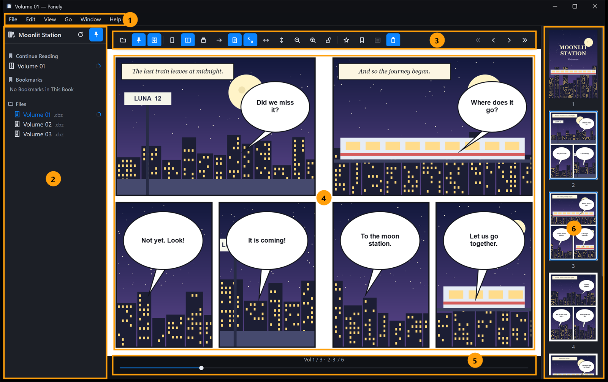</p>

| No. | Area | What it does |
|---|---|---|
| 1 | Menu bar | File, Edit, View, Go, Window, Help. Most commands are here. Hidden in full screen. |
| 2 | Library | Continue Reading, Favorites, Bookmarks and the file tree. Pinned by default. |
| 3 | Toolbar | Open, pins, layout, fit and zoom, favorites and bookmarks, thumbnails, translation, and volume/page buttons |
| 4 | Viewer | The pages. Drag to pan; double-click to zoom. |
| 5 | Page slider | Where you are (`Vol 1 / 3 · 2-3 / 6`) and a slider to move |
| 6 | Thumbnails | Page previews. Translated pages get a check badge. |

**When the toolbar and slider show**

- Unless the toolbar is pinned, they appear when the pointer nears the top or bottom edge of the viewer and fade out when it leaves.
- To keep them visible, use the toolbar's pin button or **View › Pin Toolbar** (`Ctrl+Alt+T`).
- With no book open, the toolbar always shows.

**Toolbar buttons (left to right)**

1. Open
2. Pin Library
3. Pin Toolbar
4. Single Page, Double Page, Vertical Scroll
5. Reading direction
6. Offset spread (standalone cover). Only in Double Page.
7. Fit to Screen, Fit to Width, Fit to Height
8. Zoom Out, Zoom In
9. Lock view size
10. Favorite, Bookmark Current Page, Bookmark List
11. Show Thumbnails
12. Show Translation and Choose Language. Only when translation is turned on.

At the right end are Previous Volume, Previous Page, Next Page and Next Volume.

When the window is narrow, the button groups fold into **Fit & Zoom**, **Page Layout** and **More** menus, in that order. Hover over a button to see its name and shortcut.

**Unpinning the library**

- Unpin the library (`Ctrl+Alt+S`) to give the pages more room.
- While it's unpinned, rest the pointer on the window's left edge and the library opens over the page.
- Move away or press `Esc` to close it.

**Thumbnails**: hidden at first. Open them with **View › Show Thumbnails** (`Ctrl+Alt+P`).

**Menu items not covered elsewhere**

| Menu | Items |
|---|---|
| **File** | **Clear Diagnostic Logs**, **Open Diagnostic Logs Folder**, **Clear Extraction Cache**. Same as the buttons in Settings ([chapter 8](#8-settings-and-your-data)). The extraction cache can't be cleared while a book is loading. |
| **Edit** | **Undo** (`Ctrl+Z`), **Redo** (`Ctrl+Y`), **Cut**, **Copy**, **Paste**, **Select All**. They act on the text box that has the cursor (page number, balloon editing and so on). |
| **Window** | **Reader** (brings the main window forward and focuses the page), **Jobs**, **Minimize** |
| **Help** | **About Panely**: app version and build, and the licenses of the original design and third-party components |

Some commands aren't in the menu bar, such as Change Library Folder and the per-language menu in the translation panel. Each chapter covers them.

## 3. Opening books and the library

### Ways to open a book

| How | What happens |
|---|---|
| **File › Open…** (`Ctrl+O`) | Pick an archive (CBZ, CBR, ZIP, RAR) or an image. Picking an image opens its folder as the book, at that image. |
| **File › Open Folder…** | Open a folder of images, or a series folder with several volumes. |
| Drag and drop | Drop a file or folder on the window. If you drop several, only the first opens. |
| File Explorer | If you added "Open with Panely", open straight from Explorer (see below). |
| Library | Click an item in the file tree, Continue Reading, Favorites or Bookmarks. |

Panely runs as a single window. If it's already running, a book you open from Explorer opens in that window.

While a book opens, the viewer shows a loading indicator. If a large archive takes too long, click **Cancel** on it to stop opening.

### Supported formats

| Kind | Extensions |
|---|---|
| Images | JPEG (`.jpg` `.jpeg`), PNG, WebP, GIF, HEIC/HEIF, BMP, TIFF (`.tif` `.tiff`) |
| Archives | ZIP/CBZ, RAR/CBR (RAR4, RAR5, solid RAR) |

- The archive type is detected from the file's contents, not its extension. A `.cbr` that is really a ZIP still opens.
- Pages are sorted naturally ("2" comes before "10").
- Hidden files, `__MACOSX` and files starting with `._` are skipped.
- GIFs show their first frame. EXIF rotation in photos is applied.
- **Password-protected archives aren't supported.** Opening one shows "Password-protected archives are not supported."
- A page that can't be read shows a "Couldn't read this page." tile; you can keep reading the rest.

### Folders and series

- **A folder that holds images directly** is one book. Its subfolders aren't included as pages.
- **A folder with several volumes** (two or more subfolders or archives) is treated as a series. Opening it opens the first volume.
- The other volumes in the same folder become the previous and next volumes.
- Opening a folder makes it the root of the library's **Files** tree, and it shows again the next time you start Panely.
- To change the tree root without opening a book, right-click the library header and choose **Change Library Root…**.

**Archives inside an archive**

- Opened up to 3 levels deep. A **Volumes** list then appears in the library.
- For safety, the extracted size is limited to 5 GiB and the file count to 100,000.
- These archives, and solid RARs, are extracted to the extraction cache before reading (see [section 8](#8-settings-and-your-data)).

### The library

The library shows these sections, top to bottom. Empty sections may not appear.

| Section | Contents |
|---|---|
| **Continue Reading** | The unfinished book you read most recently. Right-click › **Remove from Continue Reading** forgets its progress. |
| **Volumes** | The volumes inside an archive (only for archives inside an archive) |
| **Favorites** | Books you've added to Favorites |
| **Bookmarks** | Page bookmarks in the current book, or "No Bookmarks in This Book" |
| **Bookmarks in Other Books** | Bookmarks you left in other books |
| **Files** | The tree of subfolders and archives under the library folder |

**The file tree**

- Only folders and archives are listed; image files aren't.
- Click to open. Right-click for **Open This Book** and **Show in Explorer**.
- Progress marks (hover one for a description such as "40% read")
  - a ring: how much you've read
  - a dot in the ring: in progress, page count not known yet
  - a check mark: finished (shown once you reach the last spread)
- The tree refreshes by itself when the folder changes. You can also use the header's **Refresh File Tree** button.
  - If too much changes at once, "Too many changes to follow automatically…" appears. Click the refresh button.
- With no library folder set, you see "Select a folder to browse books from." and a **Pick Folder…** button.

**Recent books** are in **File › Open Recent**, not in the library.

- The menu shows the last 10 books.
- Books that can't be opened are marked "(Unavailable)".
- **Clear Menu** empties the list.

### Favorites

- **Add or remove**: the toolbar star, **Go › Add to Favorites** (`Ctrl+Shift+D`), or the page's right-click menu.
- Clicking a favorite opens the book where you left off.
- To remove one from the library, right-click it › **Remove from Favorites**.

### Page bookmarks

**Add or remove**

- Use the toolbar bookmark button, **Go › Add Page Bookmark** (`Ctrl+D`), or the page's right-click menu.
- In Double Page, the bookmark goes on the first page of the spread.

**Move between them**

- **Go › Previous Bookmark** (`Ctrl+Shift+[`) and **Next Bookmark** (`Ctrl+Shift+]`)
- The **Go › Bookmarks** submenu, the toolbar's **Bookmark List**, or the library's Bookmarks section
- Bookmarks in other books are under **Go › Bookmarks › Other Books**.

**Delete**

- The × button that appears when you hover a bookmark in the library
- Right-click a bookmark in the library for **Remove Bookmark** or **Remove This Book's Bookmarks…**
- The trash button in the library's **Bookmarks** header (**Remove All Bookmarks in This Book…**), shown only when this book has bookmarks
- **Go › Remove All Bookmarks in This Book…** and **Remove All Bookmarks…**
- Removing several at once asks first, and the bookmarks can't be restored.

**Limits**: 500 bookmarks per book, and up to 200 books with bookmarks. Past that, the oldest are dropped.

### "Open with Panely" in File Explorer

Click **Add to File Explorer** in **Settings › General › File Explorer**. This changes the following:

- Panely is added to the "Open with" list for CBZ, CBR, ZIP and RAR files.
- Panely becomes the default app for CBZ and CBR only if they don't have one yet. Default apps for ZIP and RAR aren't changed.
- Right-clicking a folder shows **Open in Panely**.

**Remove from File Explorer** removes all of the above. The registration applies to your user account only, so no administrator rights are needed.

## 4. Reading

### Page layouts

| Layout | Shortcut | Description |
|---|---|---|
| **Single Page** | `Ctrl+Shift+1` | One page at a time |
| **Double Page** | `Ctrl+Shift+2` | Two pages side by side (1-2, 3-4, …) |
| **Vertical Scroll** | `Ctrl+Shift+3` | Pages joined top to bottom, like a webtoon |

Changing the layout keeps the page you're on.

<p align="center">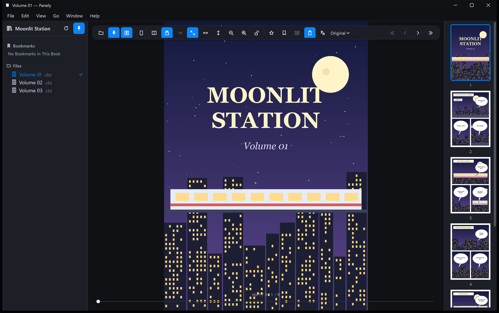</p>

**Standalone cover**

- In Double Page, turn on the toolbar's **Offset spread (standalone cover)** button, or the **View** menu item with the same name.
- With it on, page 1 is shown alone, then 2-3, 4-5 and so on.
- This setting applies to all books.

### Reading direction

For right-to-left books such as manga, switch the direction with the toolbar's arrow button (→/←) or the reading-direction item in the **View** menu. The menu item is checked when the direction is right to left.

**What right to left changes**

- the order of the two pages in a spread
- which way `←` and `→` go
- where a zoomed page starts (at its right edge)

**What it doesn't change**

- the page slider, and the toolbar's previous/next page buttons
- In Vertical Scroll the direction is fixed to left to right, and the button is disabled.

### Fit and zoom

| Command | Shortcut |
|---|---|
| **Fit to Screen** | `Ctrl+1` |
| **Fit to Width** | `Ctrl+2` |
| **Fit to Height** | `Ctrl+3` |
| **Zoom In** / **Zoom Out** | `Ctrl++` / `Ctrl+-` |
| **Reset Zoom** | `Ctrl+0` |

- Choosing the fit that's already active resets the zoom to the fitted size.
- `Ctrl`+mouse wheel zooms around the pointer. On a precision touchpad, pinch works too.
- On a touchscreen, pinch with two fingers to zoom and drag with a finger to move the page.
- Double-click a page to switch between the fitted size and 2×.
- Drag a zoomed page to move it. `Shift`+wheel, a tilt (horizontal) wheel and sideways touchpad scrolling scroll sideways.
- Zoom ranges from 10% to 1000%.

### Lock view size

Turn on the toolbar's lock button or **View › Lock View Size** (`Ctrl+L`) to keep the current zoom when the window is resized.

- When unlocked, the page fits again after a resize, unless you've zoomed it yourself.
- This button is the opposite of **Settings › General › Fit pages again when the window is resized**; both change the same setting.

### What's remembered per series

- Layout, reading direction and fit are saved for each series (the folder that holds the volumes).
- Your last choice becomes the default for new series.
- A zoom you set by hand is remembered only while the app is running.

### Full screen

Press `F11` or choose **View › Enter Full Screen**. The menu bar hides; press `Esc` or `F11` to leave.

## 5. Moving between pages and volumes

### Keyboard

| Key | Action |
|---|---|
| `Space`, `→` | Next page (spread). In right-to-left reading, `←` is next |
| `←` | Previous page. In right-to-left reading, `→` is previous |
| `Page Down` / `Page Up` | Next / previous page. In Vertical Scroll, scrolls 90% of the window height |
| `↓` / `↑` | Scroll a little in Vertical Scroll or on a zoomed page |
| `Home` / `End` | First page / last page |
| `[` / `]` | Previous volume / next volume |
| `Ctrl+G` | Go to page |

When focus is in the library tree, the thumbnail list or a text box, these keys act there instead. Click the page once first.

### Mouse wheel

- In Single Page and Double Page, the wheel turns pages.
  - If a zoomed page is larger than the window, the wheel scrolls first; at the edge, one more notch turns the page.
- In Vertical Scroll, the wheel only scrolls.
- To stop the wheel turning pages, use **View › Disable Scroll Page Turning** or turn off **Settings › General › Turn pages with the scroll wheel**.

### Slider, page number and thumbnails

- **Page slider**: drag it to jump straight to a page.
- **Page number above the slider**: click it to type a number. `Enter` jumps there; `Esc` cancels.
- **Go to Page** (`Ctrl+G`): asks for a page number. A number out of range goes to the first or last page.
- **Thumbnails**: click one to go to that page. The pages on screen have a blue outline.

### The page's right-click menu

Right-click the page for:

- **Add Page Bookmark** (or **Remove**), **Add to Favorites** (or **Remove**), **Go to Page…**
- **Fit to Screen**, **Fit to Width**, **Fit to Height**
- With Translation Assist on, **Translate This Page Again**, **Add a Balloon Here…**, **Improve with an AI Chat…** and **Edit Balloons** appear at the top ([chapter 7](#7-editing-and-exporting-translations)).

### Previous and next volume

- Use **Go › Previous Volume** / **Next Volume** (`[` / `]`) or the « » buttons at the toolbar's right end to move to the volumes before and after this one in the same folder.
- At the first or last volume in the folder, Panely tells you.

**Turning past the end of a book**

- On the last spread, an **Up next** card appears at the bottom.
- Turn the page once more (`Space`, arrow keys or the wheel) or click **Open** to open the next volume at page 1.
- **Read Again from the Start** clears this book's finished mark and goes back to page 1.

<p align="center">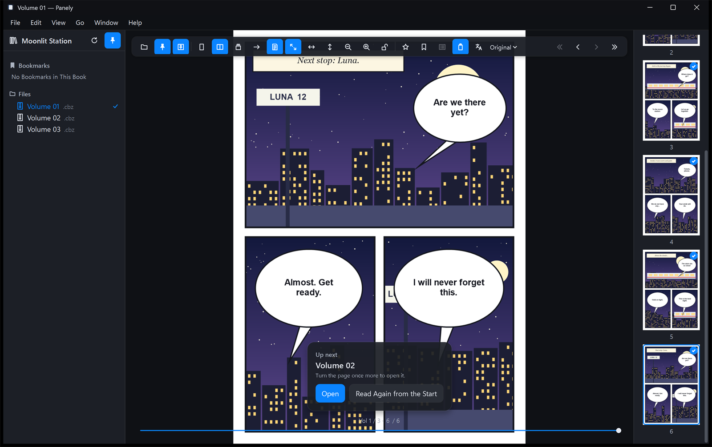</p>

**Going back from the first spread**

- If you go back from the first spread, a **Previous Volume** card appears at the top.
- Going back once more opens the previous volume where you left off.

> [!NOTE]
> In Vertical Scroll the wheel doesn't move on to the next volume; use `Space` or the arrow keys. The toolbar's previous/next page buttons (‹ ›) also stay within the current book.

### Picking up where you left off

- Your position is saved as you turn pages, and a book reopens there.
- When you start Panely again, only the last library folder is restored; no book opens by itself. Click **Continue Reading**.
- **File › Reload Book** (`Ctrl+R`) reads the book again and keeps your page.
- If the open book's file changes, a "This book changed on disk." banner appears. Click **Reload** to pick up the change.

## 6. Getting started with translation

Translation is experimental. Panely finds speech balloons, reads their text, and draws a machine translation over the page.

- Everything runs on your PC. The only network use is downloading language packs.
- It's meant to help you follow the story, not to replace a real translation.
- **Supported languages**: Japanese, Chinese (Simplified), Chinese (Traditional), Korean and English. Any of the five can be the book's language or the target (including Simplified ↔ Traditional Chinese).

<p align="center"></p>

### Step 1: Turn translation on

Open **File › Settings…** (`Ctrl+,`). On the **Experimental** tab, turn on the **Translation Assist** switch. These then appear:

- Toolbar: the translation button and the Choose Language button
- **View** menu: the translation items
- **File › Export Translated Book…**
- **Window › Jobs**

<p align="center">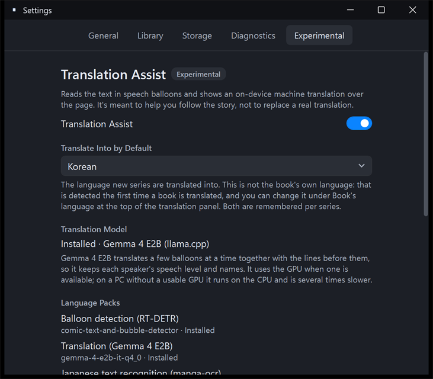</p>

The other settings on this tab:

- **Translate Into by Default**: the language new series are translated into. You can change it for each series.
- **Translation Model**: translation uses one model, Gemma 4 E2B. It translates a few balloons at a time together with the lines just before them, so it keeps each speaker's speech level and names. Once installed, the device it runs on (a Vulkan GPU name, or CPU) is shown too; the device is picked at the first translation.

### Step 2: Download the language packs

Translation needs the models (language packs) below. They're downloaded from pinned revisions on Hugging Face and checked against SHA-256 checksums before they're installed. Panely doesn't redistribute them.

| Language pack | Size | Needed for |
|---|---|---|
| Balloon detection (RT-DETR) | 160.7 MB | Always |
| Chinese, English and Korean text recognition, language detection (PP-OCRv5) | 40.9 MB | Always |
| Japanese text recognition (manga-ocr) | 111.4 MB | Japanese books |
| Translation (Gemma 4 E2B) | 3.1 GB | Always |

The total is about 3.4 GB for Japanese books and about 3.3 GB for other languages.

Translation packs from earlier versions (Fast and Accurate, M2M100) are no longer used, so Panely deletes them when it starts.

**Two ways to download**

- The **Download Language Pack…** button in the **translation panel** (step 3 below) downloads every pack you need, one after another, then starts translating.
- **Settings › Experimental › Language Packs** has a **Download…** button for each pack. This only downloads; it doesn't start a translation.

<p align="center">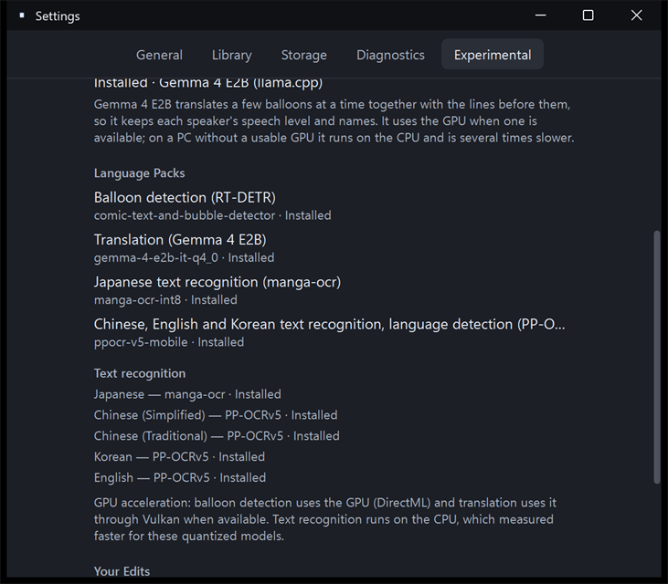</p>

While they download, the translation panel shows the pack being downloaded and the overall size (for example "Downloading Translation (Gemma 4 E2B) · 1.1 GB of 3.1 GB") with a progress bar. If you close the panel, "Downloading language packs · 1.1 GB of 3.1 GB" shows at the bottom of the viewer. On the development PC the translation pack (3.1 GB) took about 2 minutes; it depends on your connection.

A translation that was waiting for language packs continues by itself once they're downloaded, without restarting Panely, whether you downloaded them from the translation panel or from Settings.

Language packs are stored in `%LOCALAPPDATA%\Panely\Models`. Once they're installed, translation works offline.

**Text recognition status**: **Settings › Experimental › Text recognition** lists the engine used for each language (for example "Japanese — manga-ocr · Installed").

- If a language's text recognition pack is missing but Windows has text recognition (OCR) installed for that language, Panely uses Windows text recognition instead and shows "Windows OCR (fallback)".
- Windows text recognition reads horizontal lines. Vertical Japanese or Chinese text may not be read and stay untranslated, so downloading the pack is better.
- If there's no way to read the book's language, the translation panel shows **Open Windows Language Settings** and **Check Again**. Add the language (with its optical character recognition feature) in Windows Settings › Time & language › Language & region, then click **Check Again**.

> [!NOTE]
> A download can't be cancelled, and the app has no button to delete a language pack. If you quit during a download, it starts over next time.

### Step 3: Choose languages in the translation panel and start

Click the toolbar's **Choose Language** button (a language name with ▾) and choose **Translation Panel…**. For a book you haven't translated yet, the toolbar's translation button also opens the panel.

<p align="center">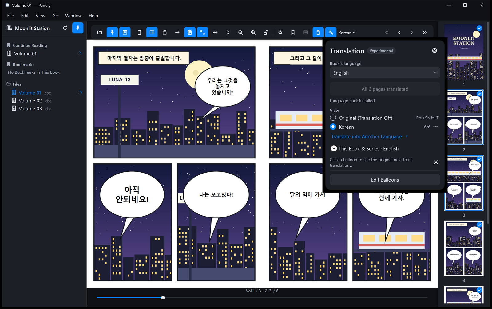</p>

1. **Book's language**: the language the book is written in.
   - With **Detect Automatically**, Panely reads up to 15 pages from the current page when translation starts, and remembers the result for the series.
   - Without the language packs the language can't be detected, so **Download Language Pack…** appears first. After the download, detection continues from there.
2. **Target language**: the language saved for the series. If there isn't one, Panely uses **Translate Into by Default**, and then the app language.
   - To translate into another language, use **Choose Language › Translate into Another Language**, or the panel's **Translate into Another Language** link.
3. Click **Translate This Book into Korean** (or whichever language). If packs are missing, **Download Language Pack…** appears here instead.
   - **View › Translate This Book** (`Ctrl+Alt+Y`) also starts it.
   - The same button and menu item pause and resume.

**How translation proceeds**

- Panely translates from the current page to the end of the book, then the earlier pages.
- Translated balloons appear on the page as they're ready. Progress shows in the panel and in a progress pill at the bottom of the viewer; click the pill to open the Jobs window.
- One job runs at a time. Jobs for other books wait their turn.
- Finished pages get a check badge in the thumbnails.
- When translation starts, the translation model gets ready while balloons are being found. On a GPU the first preparation takes about 20 seconds, but it overlaps balloon detection, so the first translation usually appears in about 10 seconds.

### On a PC without a GPU

The translation model runs on the GPU (Vulkan) when there is one, and on the CPU otherwise. On the CPU it is much slower.

| Device | One balloon | 298-page webtoon (146 balloons), whole book | First translation shown |
|---|---|---|---|
| GPU (RTX 4070 Ti SUPER) | about 0.1 s | about 58 s | about 10 s |
| CPU only (Core i7-13700K; detection, recognition and translation all on the CPU) | about 0.6 s | about 325 s (5 min 25 s) | about 15 s |

- These were measured once on the development PC. Slower CPUs, fewer cores and laptop power-saving modes take longer.
- With no GPU at all, or with the GPU turned off, balloon detection runs on the CPU too, so the number of pages matters as well as the number of balloons. If only Vulkan is missing, balloon detection still uses the GPU (DirectX 12) and can be faster than the table.
- Panely runs on the CPU in these cases:
  - the PC has no GPU
  - an older GPU without a Vulkan driver
  - Windows on ARM (this build has no ARM Vulkan binaries)
  - the GPU was turned off with `PANELY_ORT_DEVICE=cpu`
- **Settings › Experimental › Translation Model** shows which device is in use (after the first translation).
- On the CPU, it's easier to let the book translate from the current page while you read than to translate many pages ahead. Translation always starts at the current page.

### Switching between original and translation

- **How to switch**: the toolbar's translation button, **View › Show Translation** / **Hide Translation** (`Ctrl+Shift+T`), or **Original (Translation Off)** in the panel.
- This switch applies to every book.
- If you've translated into several languages, pick the one to show from the **Choose Language** menu or the translation panel. Each language shows how many pages are done.
- The **⋯** button at the right of a language in the translation panel (Translate, pause or stop this language) controls each language on its own.
  - **Translate** (first time) / **Resume** (after stopping) / **Pause** (while translating): starts or pauses that language without changing what you're viewing.
  - **Show This Language**: shows that language's translation.
  - **Stop**: stops that language's job and takes it off the list. Pages already translated are kept.
- The gear button at the top right of the translation panel (**Translation Settings**) has **Default Language** (the same as in Settings) and **Jobs** (opens the Jobs window).
- Pages that aren't translated yet show the original.
- Balloons the model couldn't translate keep their original text. Click one to see why.

> [!NOTE]
> Vertical Scroll keeps its translations separately from Single Page and Double Page, so after changing the layout you may need to translate again. Translations made by earlier versions (M2M100) aren't used, so books need translating again; your own edits are kept.

### Translating a whole series

Expand **This Book & Series** in the panel.

- **Translate This Series Automatically**: translates this book first, then the other volumes of the series in the background.
- **Translate Entire Series (N Volumes)**: queues every volume in the series. Volumes that are archives inside an archive are skipped; open each one to translate it.

## 7. Editing and exporting translations

### Looking at one balloon

While a translation is shown, click a balloon. A popover shows the original next to the translation, plus translations into any other languages you've done.

### Edit Balloons

Edit mode is where you fix what the machine got wrong: a bad translation, text that was misread, or text that wasn't found at all.

**Turning edit mode on and off**

- **On**: **View › Edit Balloons** (`Ctrl+Shift+E`), the panel's **Edit Balloons** button, or **Edit Balloons** in the page's right-click menu
- **Off**: **Done** on the edit bar, `Esc`, or **Done Editing Balloons** in the same menus
- It's available only while a translation is shown and at least one page of the book has been translated.

<p align="center">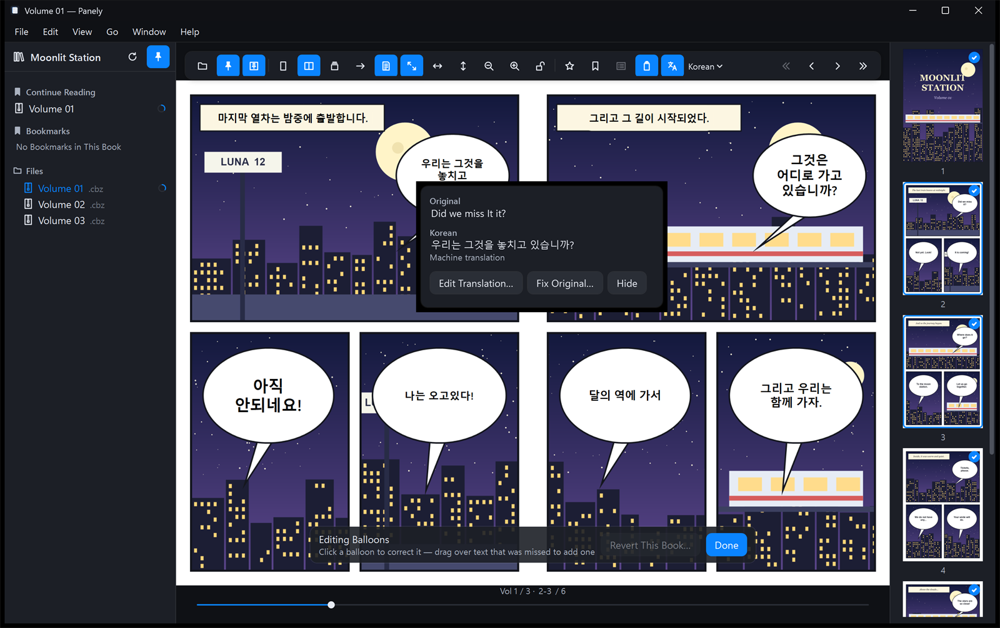</p>

**What edit mode shows**

- An **edit bar** at the bottom. Next to its title it counts the balloons you've edited and hidden in this book (for example "Editing Balloons · 2 edited · 1 Hidden").
- Balloons you've edited or added get a pencil badge at the top right.
- Balloons you added have a solid outline. Hidden balloons, and added balloons with no text, have a dashed outline.
- Outside edit mode, outlines and badges aren't drawn and hidden balloons can't be clicked.

#### Correcting a balloon

Click a balloon to open its popover.

- **Original**: the source text in use. If you corrected it, "Recognized as: …" below shows what was first read.
- **Translation** (for example Korean): the translation in the language you're viewing, with its status. Translations into other languages you've done appear below it.
- You can select and copy the original and translated text.

| Button | What it does |
|---|---|
| **Edit Translation…** | Rewrite the translation. |
| **Fix Original…** | Correct text that was read wrong. The corrected text is machine-translated again. |
| **Hide** | Hide a "balloon" where there's no real text. **Undo** appears for 6 seconds. |
| **Show This Balloon** | Only on hidden balloons. |
| **Remove** | Only on balloons you added. Deletes that balloon. |
| **Revert** ▸ | Only on edited balloons: **Use Machine Translation** (the translation only), **Restore Original** (the recognized original and its machine translation), **Revert Both** |

Right-clicking a balloon shows the same actions as a menu (**Hide This Balloon**, **Remove This Balloon** and so on). The popover and right-click menu also work outside edit mode.

**In the text box**

- `Enter` saves, `Shift+Enter` (or `Ctrl+Enter`, `Alt+Enter`) adds a new line, `Esc` cancels.
- An `Enter` pressed while an IME (Korean, Japanese, Chinese input) is composing only commits the characters; it doesn't save.

**When you fix the original**

- The corrected text is translated again into the language you're viewing and into every other language this book already has. While that runs, the popover shows "Translating…".
- A translation you typed yourself isn't overwritten. To see the machine translation of the corrected text, choose **Revert › Use Machine Translation**.

**Status shown in the popover**

| Status | Meaning |
|---|---|
| Machine translation | The machine translation, untouched |
| Your translation | Changed with **Edit Translation** or an AI chat |
| Machine translation of your corrected original | Translated again after **Fix Original** |
| Original corrected — not translated again yet | Waiting to be translated again |
| Couldn't translate this balloon, so the original is shown… | The model couldn't translate it. Type one with **Edit Translation**. |
| Balloon you added — machine translation of its text | The translation of a balloon you added |
| Balloon you added — no text was read… | A balloon you added where no text was read |
| Balloon you added — not translated into this language yet | A balloon you added, viewed in another language |

#### Adding a balloon over text that wasn't recognized

Text the balloon detector missed (signs, handwriting, lines outside balloons, small print) stays untranslated, in the original. Mark the area yourself and Panely reads just that area again (text recognition), translates it, and draws the translation on the page.

<p align="center">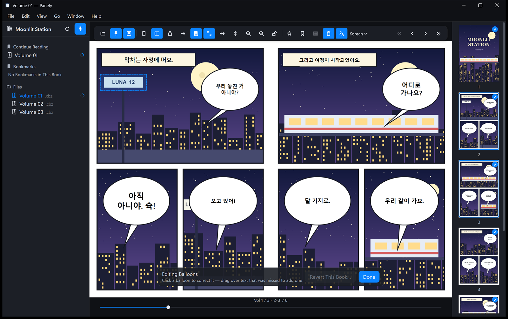</p>

1. Turn on edit mode.
2. Drag a rectangle that comfortably covers the untranslated text. A dashed rectangle follows the pointer.
   - Starting on an existing balloon opens that balloon's popover instead. Start where there's no balloon.
   - Very small rectangles (under 8 pixels wide or tall in the original image) are ignored.
3. Release the button. Panely reads the text in that area in the book's language and translates it into the language you're viewing.
   - When it's done, "Balloon added. It's translated now; click it to correct the text or remove it." appears briefly and the translation is drawn in place.
   - The background color and whether the text is vertical are also taken from that area, so it's drawn like the other balloons.
4. The added balloon has a solid outline and a pencil badge. Click it to check what was read and the translation, and to use **Edit Translation…**, **Fix Original…** or **Remove**.

<p align="center">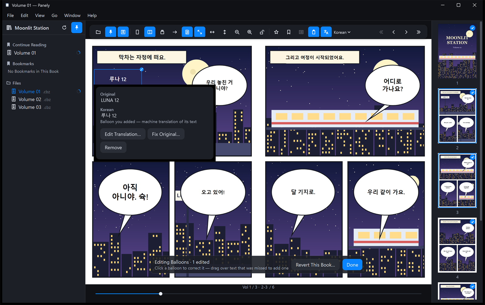</p>

**When no text could be read**

- If nothing is found in the area, an empty balloon (dashed outline) is added and "Balloon added, but no text could be read there…" appears.
- Click the dashed outline and type the original with **Fix Original…**; that text is then translated.
- If only part was read, or it was misread, correct it the same way with **Fix Original…**.
- In an area you mark, pieces with only numbers (such as "12" on a "LUNA 12" sign) are kept, and pieces on the same line are joined in reading order.
- If the book's language isn't known yet (before detection), or the text recognition pack for that language is missing, the balloon is added empty without reading any text.

**Adding from the right-click menu**

- Right-click the page and choose **Add a Balloon Here…**. Panely takes a fixed-size area centered on that spot (about 18% × 12% of the page width) and reads and translates it the same way.
- It works outside edit mode too, and turns edit mode on.
- You can't choose the size this way, so dragging is better for fitting the text exactly.

**Balloons you add**

- are stored with your edits, so clearing the translation cache or translating again keeps them.
- are included in exports and in Improve with an AI Chat.
- show "not translated into this language yet" when you switch to another language. Saving with **Fix Original…** translates them into that language too.
- are stored per layout. A balloon added in Single or Double Page doesn't appear in Vertical Scroll, and the other way round.

#### Hidden balloons and reverting a book

- **Hidden balloons**: shown as dashed outlines in edit mode. Click one and choose **Show This Balloon** to bring it back.
- **Show All Hidden Balloons** (on the edit bar, only when something is hidden) or **View › Show Hidden Balloons**: brings back every hidden balloon in this book.
- **Revert This Book…** (on the edit bar): after a confirmation ("Revert all N edited balloons in this book?"), removes every balloon you edited, hid or added in this book and goes back to the machine translation. Other books keep their edits.

#### Translating again

- **Translate This Page Again**: in the page's right-click menu and the **Choose Language** menu. Reads and translates the page on screen again; balloons split in two may be joined.
- **Translate This Book Again…**: under **This Book & Series** in the panel.
- Your edits are stored apart from the translation cache, so clearing the cache or translating again keeps them. But if a balloon is found differently after translating again, an edit on it may no longer apply.
- To remove all your edits, use **Settings › Experimental › Delete All Edits…**.

### Improving with an AI chat

The translation model only sees the few lines just before each balloon, so it can miss relationships and names set up earlier in the book. You can hand the whole book's dialogue to an AI chat you already use (ChatGPT, Claude, Gemini or another) as a text file.

Open **Choose Language › Improve with an AI Chat…**. It's also in the page's right-click menu and in the panel.

<p align="center">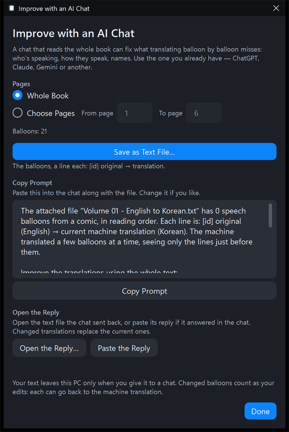</p>

1. Under **Pages**, choose **Whole Book** or **Choose Pages** (from and to page).
2. Click **Save as Text File…**.
   - Each balloon is one line in the form `[p12-3] original → translation`.
   - Hidden balloons and balloons without a translation are left out.
3. Click **Copy Prompt** and paste the prompt into a new chat with the saved file attached. You can edit the prompt.
4. Bring the reply back.
   - If the chat sent back a file, click **Open the Reply…**.
   - If it answered in the chat, copy the whole reply and click **Paste the Reply**.
5. Only changed translations are applied. The result lists how many changed, how many were already right, and any balloons that didn't come back.
   - For missing balloons, ask the chat for those, or choose fewer pages.
   - **Undo This Reply** puts back the translations this reply changed.

Applied translations count as your own edits, so each balloon can go back with **Revert › Use Machine Translation**.

> [!NOTE]
> Your text leaves this PC only when you give it to a chat yourself. Panely doesn't connect to any chat service.

### Exporting a translated book

Save the book with its translation drawn in as a new file. The original files aren't changed.

**Where to find it**

- **File › Export Translated Book…**
- the **Choose Language** menu
- **This Book & Series** in the panel
- the right-click menu on a book or folder in the library

<p align="center">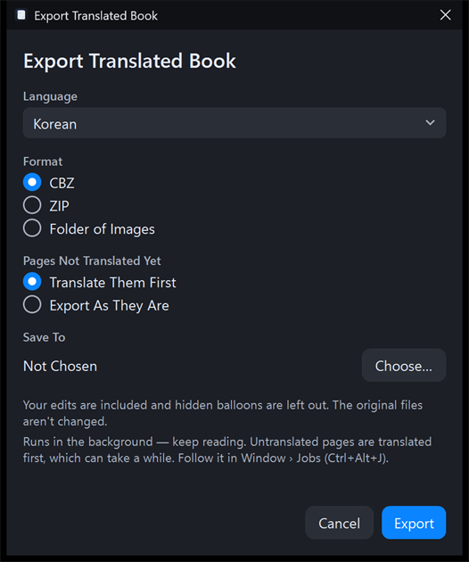</p>

| Option | Choices |
|---|---|
| **Language** | The translation language to export |
| **Format** | CBZ, ZIP, Folder of Images |
| **Pages Not Translated Yet** | **Translate Them First** (default) or **Export As They Are** |
| **Save To** | Pick a folder with **Choose…** |

**What the export contains**

- Every page of the book is included.
  - Translated pages are saved as images with the translation drawn in. PNG stays PNG; everything else becomes JPEG (quality 92).
  - Pages without a translation are copied as they are.
- Your edits are included; hidden balloons are left out.
- The file is named `<Title> [Korean].cbz`, with the language name in the app's language.
- If that name exists, " 2", " 3" and so on are added. Existing files are never overwritten.
- The format, the choice for pages not translated yet and the folder are remembered for the next export.

**Exporting a whole series**

- Use **Export Translated Series (N Volumes)…** under **This Book & Series** in the panel, or right-click a folder with several volumes in the library. It appears only when the series has two or more volumes.
- The window title becomes **Export Translated Series** and lists the volumes at the top. The options are the same as for one book.
- Each volume becomes its own file (or folder). With **Translate Them First**, volumes not translated yet are translated first.
- Volumes inside another archive exist only while that archive is open. Keep the book open until the export finishes.

**How it runs**

- Exports run in the background, so you can keep reading.
- Follow progress in **Window › Jobs** (`Ctrl+Alt+J`).
- While writing, Panely uses a `.partial` temporary file and renames it when done.

### The Jobs window

Open it with **Window › Jobs** (`Ctrl+Alt+J`), **Choose Language › Jobs**, the translation panel's gear menu, or by clicking the progress pill at the bottom of the viewer. The pill also reports other books' translations and exports: running, finished or failed.

<p align="center">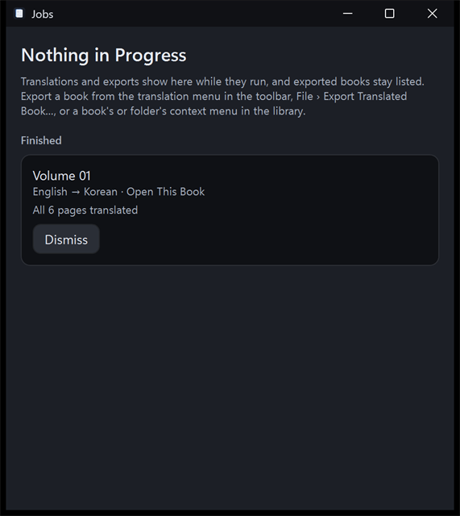</p>

| Section | Contents |
|---|---|
| **Translation** | Translation jobs that are running, queued, paused or failed |
| **Export** | Exports that are running, failed or cancelled |
| **Finished** | Translations finished in this session |
| **Exported** | Exported files (up to 50). **Clear List** only forgets the list; the files stay. |

The buttons depend on the job's state:

- **Translation jobs**: **Pause**, **Resume** (**Try Again** after a failure), **Stop** (**Dismiss** once finished or failed). Jobs for a book that isn't open also have **Open This Book**.
- **Exports**: **Cancel Export** while running; **Try Again** and **Dismiss** once failed or cancelled
- **Exported books**: **Open**, **Show in Explorer**

**When you quit Panely**

- If a translation or export is running, Panely asks "Exit Panely?" first.
- Quitting clears the job list.
- **What's kept**
  - pages already translated
  - your edits
  - the export history
  - per-series translation settings
- Translate the same book again after restarting, and Panely skips the pages already done. Series with **Translate This Series Automatically** on restart by themselves when you open the book.

## 8. Settings and your data

Open **File › Settings…** (`Ctrl+,`). Changes are saved right away. Press `Esc` to close the window.

<p align="center">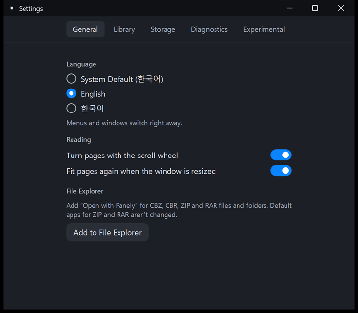</p>

| Tab | Settings |
|---|---|
| **General** | **Language** (System Default, English, 한국어; changes right away) · Turn pages with the scroll wheel · Fit pages again when the window is resized · File Explorer |
| **Library** | Reopen last folder on launch · Last opened folder and **Forget Now** · Refresh the file tree automatically |
| **Storage** | Extraction cache size, clearable cache, cache limit (10 GB) · **Clear Cache** (the open book's cache is kept) |
| **Diagnostics** | App version, build, Windows version · Log level · **Export Diagnostic Report…**, **Clear Logs**, **Open Logs Folder** |
| **Experimental** | Translation Assist, default target language, Translation Model (install status and device), language packs, text recognition status, GPU acceleration, your edits, translation cache |

**Language**: **System Default** uses Korean if Windows' display language is Korean, and English otherwise.

**The Diagnostics tab** also shows the session ID, the file log's size and the log retention limit (768 KB at most; reports include up to 256 KB). These help when you report a problem.

**Clear Translation Cache** (Experimental tab)

- Deletes every saved machine translation, right away and without asking.
- Also stops every running translation job. Start translating again to rebuild it.
- Your edits (`Data\edits\`) aren't deleted. Remove those separately with **Delete All Edits…**.

**Extraction cache**

- This is where archives inside archives and solid RARs are extracted. Ordinary ZIP and RAR files are read in place, without the cache.
- Past 10 GB, the least recently used entries are deleted automatically.

**Diagnostic report**

- A ZIP to attach when you report a problem. You choose where to save it; Panely never sends it anywhere.
- Full paths, your user name, recognized text and translations are left out. Book file names may be included.

### Where your data is stored

All your data is under `%LOCALAPPDATA%\Panely`. Nothing is written to the app folder.

| Path | Contents | If you delete it |
|---|---|---|
| `Data\state.json` | Settings, recent books, reading positions, finished marks, favorites, bookmarks, per-series view and translation settings, export history | Everything resets to defaults |
| `Data\edits\` | Translations and originals you edited, hidden balloons | Your edits are lost |
| `Cache\extraction\` | Extraction cache | Rebuilt the next time you open the book |
| `Cache\translation\` | Machine translations | Books must be translated again |
| `Models\` | Language packs | Packs must be downloaded again |
| `Diagnostics\` | Diagnostic log | Only the log is lost |

- If `Data\state.json` is damaged, Panely keeps a copy, starts with default settings and tells you so.
- The registry is written only when you add "Open with Panely", under your user account (`HKCU\Software\Classes`). Removing it deletes those keys.

## 9. Keyboard shortcuts

Hover over a menu item or toolbar button to see its shortcut. Page layouts (`Ctrl+Shift+1`/`2`/`3`) use the top-row digits only. Fit and zoom (`Ctrl+1`/`2`/`3`, `Ctrl+0`, `Ctrl++`, `Ctrl+-`) also work with the numeric keypad.

**File and window**

| Action | Shortcut |
|---|---|
| Open | `Ctrl+O` |
| Reload Book | `Ctrl+R` |
| Settings | `Ctrl+,` |
| Pin Library / Pin Toolbar / Thumbnails | `Ctrl+Alt+S` / `Ctrl+Alt+T` / `Ctrl+Alt+P` |
| Full screen | `F11` (leave with `Esc`) |
| Exit | `Alt+F4` |

**View**

| Action | Shortcut |
|---|---|
| Single Page / Double Page / Vertical Scroll | `Ctrl+Shift+1` / `2` / `3` |
| Fit to Screen / Width / Height | `Ctrl+1` / `2` / `3` |
| Zoom In / Zoom Out / Reset Zoom | `Ctrl++` / `Ctrl+-` / `Ctrl+0` |
| Lock View Size | `Ctrl+L` |
| Zoom around the pointer | `Ctrl`+wheel |
| Fitted size ↔ 2× | Double-click the page |
| Scroll sideways | `Shift`+wheel |

**Go**

| Action | Shortcut |
|---|---|
| Next / previous page | `Space`, `→` / `←` (reversed in right-to-left reading), `Page Down` / `Page Up` |
| First / last page | `Home` / `End` |
| Go to Page | `Ctrl+G` |
| Previous / next volume | `[` / `]` (or `Ctrl+[` / `Ctrl+]`) |
| Add or remove page bookmark | `Ctrl+D` |
| Previous / next bookmark | `Ctrl+Shift+[` / `Ctrl+Shift+]` |
| Add or remove favorite | `Ctrl+Shift+D` |

**Translation** (when Translation Assist is on)

| Action | Shortcut |
|---|---|
| Show / Hide Translation | `Ctrl+Shift+T` |
| Translate This Book / Pause Translating | `Ctrl+Alt+Y` |
| Edit Balloons / Done Editing | `Ctrl+Shift+E` (leave editing with `Esc`) |
| Edit Translation / Fix Original text box: save / new line / cancel | `Enter` / `Shift+Enter` / `Esc` |
| Jobs | `Ctrl+Alt+J` |

## 10. Troubleshooting and known limitations

### Common problems

| Symptom | What to do |
|---|---|
| "Windows protected your PC" on launch | The app isn't code-signed. Choose **More info › Run anyway**. |
| "Password-protected archives are not supported." | Re-create the archive without a password, then open it. |
| "This book is currently unavailable. Reconnect its drive or restore the file." | Reconnect the external drive or network folder, then click **Retry**. Books that can't be opened are never removed from your lists automatically. |
| A recent book doesn't open after you moved it | Use **Remove from List** on the error banner, then open it from its new place. A file moved within the same drive keeps its reading position and bookmarks when you open it from the new place. |
| "Open with Panely" stopped working after moving the app folder | Click **Add to File Explorer** again in **Settings › General**. |
| No translation button | Turn on **Settings › Experimental › Translation Assist**. |
| "Couldn't tell which language this book is in." | Choose the language yourself under **Book's language** at the top of the translation panel. |
| Translation fails or the app is unstable because of the GPU | Make Panely use the CPU only by setting this environment variable, then start Panely again: `setx PANELY_ORT_DEVICE cpu`. Translation becomes several times slower ([On a PC without a GPU](#on-a-pc-without-a-gpu)). |
| Translation is very slow | If **Settings › Experimental › Translation Model** shows CPU, the GPU isn't being used. Installing the latest graphics driver often makes Vulkan available. |

When you report a problem, please attach a ZIP from **File › Export Diagnostic Report…**. [Open a new issue](https://github.com/sejoung/PanelyWindows/issues/new)

### Known limitations

These come from this release and the [implementation status](IMPLEMENTATION-STATUS.md) (in Korean).

**Translation**

- The translation model (Gemma 4 E2B) is a small on-device model and makes mistakes. Quality hasn't been checked against a reference (golden) set; there is only the developer's side-by-side comparison with the earlier model. When text recognition such as manga-ocr misreads the original, the translation is wrong too.
- Speech level is matched from the few lines just before each balloon, so it can be wrong after a scene change or for a speaker who appeared long before.
- On a PC without a GPU, translation runs on the CPU and is several times slower ([On a PC without a GPU](#on-a-pc-without-a-gpu)). Translating uses several GB of memory (measured on the development PC: up to about 7.5 GB, including balloon detection).
- Vertical Chinese text hasn't been measured.
- In narration boxes that the text nearly fills, the translation patch may be drawn semi-transparent, so the original faintly shows through.
- Translation jobs in progress are lost when you quit. Finished pages are kept.
- Language pack downloads can't be cancelled, and the app can't delete a language pack.
- Drag-to-add in Edit Balloons has been checked with the demo comic, but not every other action in Edit Balloons and the AI chat window has been checked by hand.- Until you click **Save as Text File…**, the AI chat prompt shows a balloon count of 0. Save the file first, then copy the prompt.
- Series auto-translate and Translate Entire Series skip volumes that are archives inside an archive. For such a book, translation pauses when you open another book.

**Environment**

- Not tested yet: ARM64 devices, 125%/150% and mixed DPI, high-contrast mode, and HEIC/WebP on a clean PC without codecs.
- Unplugging network or removable drives, and automatic file-tree refresh on network folders, haven't been tested on real setups.
- There's no installer and no code signing yet. Panely ships as a portable ZIP.
